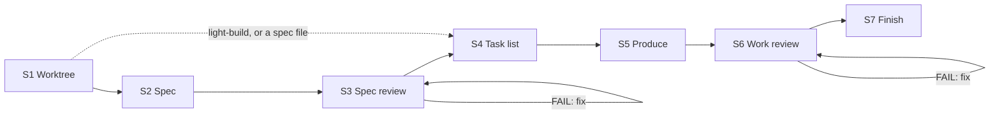
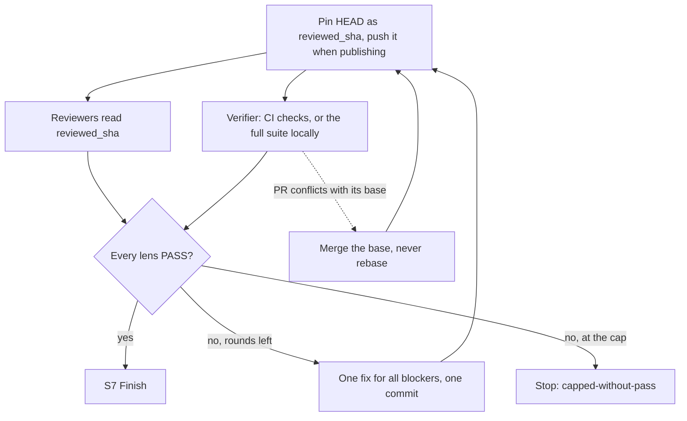

# Claude Autopilot

A Claude Code and Codex plugin that turns one requirement into a review-ready git branch
without asking you anything. It writes the work itself (code, docs, designs, data, plans),
independent reviewer agents judge it, and it fixes until they all pass. It never merges.

> Status: **v1.9.3**

## Install

In Claude Code, this repo is its own marketplace:

```
/plugin marketplace add https://github.com/ophis/claude-autopilot.git
/plugin install autopilot@claude-autopilot
```

`ophis/claude-autopilot`, a local path or the `/plugin` menu also work. Releases use
explicit semver (currently `1.9.3`). To update, run `/plugin marketplace update claude-autopilot`,
then the install line again. No other plugin is needed.

**Codex.** Invoke the `autopilot:build` or `autopilot:light-build` skill with your
requirement, or ask Codex to run a checkout's absolute `skills/build/SKILL.md` or
`skills/light-build/SKILL.md`. Needs subagent support. Reviewers inherit the session
model. No Codex marketplace manifest yet.

## Use

```
/autopilot:build add a function add(a,b) with a passing unit test
/autopilot:build path/to/spec.md
/autopilot:light-build add a --json flag to the status command
```

Expect a new worktree and branch, review loops that end in `VERDICT: PASS`, tests that
really ran, one commit per task and per fix round, a final report, and no merge. Given a
self-contained spec file, build skips S2 and S3. To iterate, run the next requirement from
the finished run's branch. It continues that branch, with its own plan doc, a review of only its new
commits, and the same PR.

|  | `build` | `light-build` |
| --- | --- | --- |
| Steps | S1–S7 | S1, S4–S7 |
| Spec | written (S2), reviewed (S3) | the requirement is the spec |
| S6 panel | every core lens, plus the optional lenses the change matches | pinned: correctness, requirement-fidelity, doc, verification |
| S6 re-review | failed lenses, plus every core lens | failed lenses, plus the verifier, plus correctness after a verifier FAIL |
| Cap | 3 rounds per review phase, changeable in the requirement | 3 rounds |
| Fits | complex work | simple tasks, or autonomy without spec rigor |

light-build gates no scope. It runs whatever you give it. Picking the skill is your call.

## How a run works



| Step | What happens |
| --- | --- |
| S1 Worktree | Stays on any branch but `main`, `master` or origin's default. Otherwise creates a worktree and a branch `<prefix>-<slug>`, the prefix being the ticket ID for one-ticket work, else `autopilot`. Creates the plan doc and decides how to publish. |
| S2 Spec | Writes the spec from the requirement and the code it touches. `check-spec.py` checks its sections and that every acceptance criterion has a test or check. |
| S3 Spec review | Review loop over the spec. Each re-review covers the whole spec with the full panel. |
| S4 Task list | Code-free. Each task is one revertable commit: files, cross-task interfaces, tests to write first, the checks it runs, commit message. The full verify command sits above the tasks, with the CI checks that run its tests when publishing. |
| S5 Produce | Implements the tasks in order: new tests fail first, then the code, then checks covering only the changed files, then a commit. May hand a self-contained task to a fresh producer. No per-task review. |
| S6 Work review | Review loop over the work at a pinned commit. Each fix round is one `fix(r<N>)` commit. |
| S7 Finish | Report and integration options, a squash merge among them. Copies the plan docs to the project's plan location if its AGENTS.md or CLAUDE.md names one. |

### One work-review round



Rounds are batched: every verdict, then one fix, then one re-review. Only the reviewers'
verdicts decide, in the strict `VERDICT / BLOCKING / NON-BLOCKING` grammar; the
orchestrator never overrides one. A test command that ran 0 tests fails.

## CI and pull requests

A repo with CI never runs its full suite locally while CI can run it. The run publishes
its branch as a draft PR, and the verifier reads the CI checks for the reviewed commit
while the other reviewers read the code.

| `publish` | When | Pushes | At the end |
| --- | --- | --- | --- |
| `pr` | the requirement asks for a PR | each task commit and each S6 pin | build has posted the reviewed spec as a comment; the report goes in the PR body; PR marked ready |
| `ci` | a `pull_request` workflow, and `gh` authenticated for origin's host | each S6 pin | a draft PR, for you or a caller to adopt |
| `none` | otherwise, or a push refused in `ci` | nothing | no PR; checks ran locally |

- An open PR on the branch is adopted. A ready one goes back to draft for the run and is
  marked ready on convergence, so nobody merges it mid-review.
- S4 names the CI checks that run the tests. If none does, verification runs locally.
- A CI failure enters the fix loop like any blocker.
- CI still unfinished an hour after the verifier's first look stops the run. It never
  falls back to a local full suite.

## Decisions and stops

At a genuine fork (materially different trade-offs, or a choice costly to reverse) the run
convenes an expert council of 2–4 ad-hoc subagents, decides and logs the decision. A
delegated producer at a fork returns a `FORK:` marker instead, and the orchestrator decides
and re-dispatches it.

Every run ends with one fenced `autopilot-result` JSON block, so a caller reads the
outcome without parsing prose:

```autopilot-result
{ "status": "converged", "branch": "autopilot-add-json-flag", "base_ref": "<sha>", "head": "<sha>", "pr": "", "blockers": [], "reason": "" }
```

| `status` | When | `reason` |
| --- | --- | --- |
| `converged` | every lens passed and S7 ran | empty |
| `capped-without-pass` | a review loop hit its cap | `oscillation`, `unfixable` or `requirements-conflict` |
| `stopped` | a destructive op (force-push, write outside the worktree, history rewrite beyond the branch, rm or reset of uncommitted work) without automatic approval (Claude: Auto Mode) | `destructive-op` |
| `stopped` | a phase failure or missing capability after one retry, CI past its deadline included | `phase-failure` |
| `stopped` | a requirement that contradicts itself | `root-contradiction` |

`pr` is the run's PR URL, a draft when `publish=ci`. `blockers` lists the open blocking
items when not converged.

## Call it from a workflow

Both surfaces are skills, so another skill or workflow can call them by name. A nested run
stays on the caller's branch unless that is a default branch, where it creates its own
worktree. Its docs are named per requirement, so runs don't collide. The caller integrates
the returned branch, read from the `autopilot-result` block.

## State and resume

Each run keeps its state in one ignored plan doc, `.autopilot/<slug>-plan.md` in its
worktree (build adds a spec doc beside it): the verify command, a `RESUME:` line, the
progress log, review items, Notes of codebase facts and the task list. After a context
compaction the run rebuilds from it and `git log`. Running the same requirement again
resumes an unfinished run.

## Review roster (`agents/`)

Each reviewer has one lens. A phase's `core` lenses always run; an `optional` lens runs
when its `applies_to` matches the spec's keywords (S3) or the changed paths (S6). Ordinary
reviewers are read-only and never run the full suite.

| File | Lens | Phase | Tier |
| --- | --- | --- | --- |
| `reviewer-contract.md` | Authoring template inlined into ordinary reviewers (not dispatched); verification reviewer has a dedicated execution contract |  |  |
| `spec-fitness-reviewer.md` | Spec fitness: gaps, ambiguity, scope, testability | spec | core |
| `architecture-reviewer.md` | Structure, boundaries, coupling, extensibility | both | spec: core. work: optional, when a file is added, deleted, renamed or copied (`@structural`) |
| `correctness-reviewer.md` | Logic, edge and boundary cases, error paths | work | core |
| `requirement-fidelity-reviewer.md` | The requirement and spec built, nothing missing, drifted or added | work | core |
| `doc-reviewer.md` | Docs anywhere in the repo the change made false; bloated doc edits | work | core |
| `verification-reviewer.md` | Full checks at the reviewed SHA, locally or from CI: commands, exit codes, test and failure counts | work | core |
| `code-quality-reviewer.md` | Readability, naming, duplication, dead code, complexity, comments | work | optional: code files |
| `test-reviewer.md` | Tests assert the spec and cover new or changed code | work | optional: code or test files |
| `performance-reviewer.md` | Complexity, N+1, allocation, leaks, hotspots | work | optional: code files |
| `security-reviewer.md` | Authz, input validation, secrets, injection, supply chain | both | optional: auth, input, network, I/O, dependency or crypto signals |

`skills/build/scripts/select-panel.py` builds build's panel from each file's frontmatter
(`lens`, `phase`, `tier`, `applies_to`), so a new lens is a new file. build runs every core
lens and drops a marginal optional one only with a logged reason. On Claude Code each
reviewer runs as `autopilot:<name>` with its frontmatter `model:` and `effort:`; on Codex
it inherits the session model. A re-reviewed lens starts fresh with its prior items and,
in S6, the fix diff.

### Plugin workflow (`workflows/review-round.js`)

The default transport for a round, `Workflow({name: "autopilot:autopilot-review-round", args})`,
runs every member in parallel and schema-validates each verdict. Without Workflow, the
skills dispatch natively.

- Input `args`: `{phase, members: [{agent, subagent_type, prompt}]}`.
- Output: `{phase, verdicts: [{agent, VERDICT, BLOCKING, NON_BLOCKING, synthetic}]}`, in
  member order. `VERDICT` is `PASS` only when the reviewer said `PASS` with no `BLOCKING`.
  A member with no verdict becomes `FAIL` with `synthetic: true`; the skills re-dispatch
  it once natively.

## Local development

```
claude --plugin-dir /path/to/claude-autopilot              # load the working copy
/reload-plugins                                            # after an edit, in session
claude plugin validate /path/to/claude-autopilot --strict  # manifests and frontmatter
python3 scripts/lint-roster.py                             # after editing agents/
python3 tests/test_scripts.py                              # helper-script tests, stdlib only
```

Also run the [smoke protocol](CONTRIBUTING.md#smoke-protocol). Per-build dev docs go in
gitignored `dev-docs/<date>-<slug>-{spec,plan}.md`.

The repo is both the marketplace and the plugin:

```
claude-autopilot/
├── .claude-plugin/
│   ├── plugin.json               # name: autopilot (version 1.9.3)
│   └── marketplace.json          # name: claude-autopilot, plugins:[{source:"./"}]
├── skills/
│   ├── build/SKILL.md            # /autopilot:build
│   ├── build/spec.md             # spec-writing guide for S2
│   ├── build/scripts/select-panel.py   # (phase, signals) → panel JSON
│   ├── build/scripts/check-spec.py     # S2 spec structure and AC coverage
│   ├── build/scripts/ci-verdict.py     # one commit's CI checks → verifier verdict
│   ├── build/scripts/pr.py             # draft PR start / push / spec / finish
│   ├── build/scripts/resolve-branch.py # S1: resume / stay / reuse / create / stop
│   ├── build/scripts/_frontmatter.py   # parser shared with the roster lint
│   └── light-build/SKILL.md      # /autopilot:light-build
├── references/
│   └── autopilot-common.md       # rules both skills share
├── scripts/
│   └── lint-roster.py            # roster lint
├── workflows/
│   └── review-round.js           # plugin workflow: one parallel review round
├── agents/                       # review roster
│   ├── reviewer-contract.md      # authoring template, inlined into ordinary reviewers
│   └── *-reviewer.md             # one lens each
├── tests/
│   └── test_scripts.py           # stdlib unittest for the scripts
└── README.md
```
