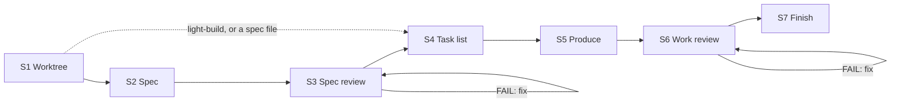
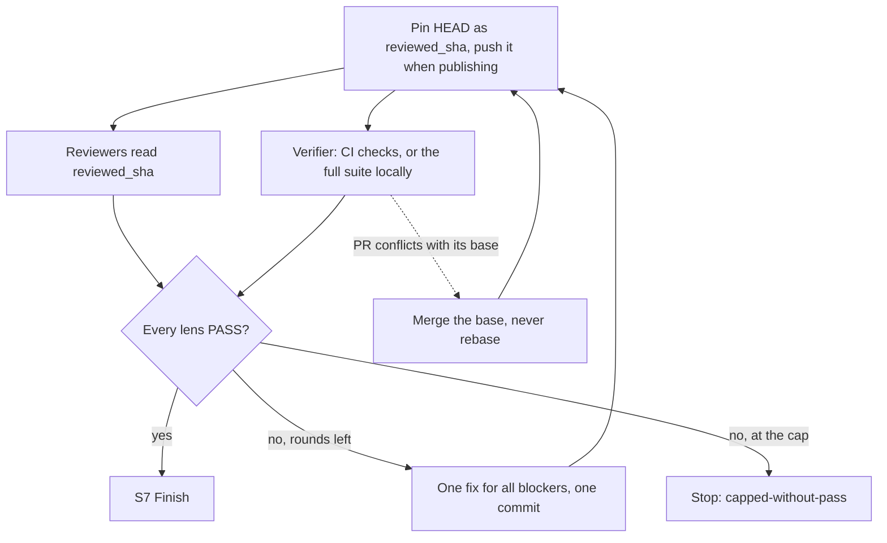

<div align="center">

#  Claude Autopilot

[English](../../README.md) · [中文](README.zh-CN.md) · [日本語](README.ja.md) · [한국어](README.ko.md) · **Español** · [Français](README.fr.md) · [Português](README.pt.md)

</div>

*Esto es una traducción; la versión de referencia es el README en inglés.*

Un plugin para Claude Code y Codex que convierte un requirement en una git branch lista para revisar
sin preguntarte nada. Hace el trabajo él mismo (código, documentación, diseños, datos, planes),
agentes reviewer independientes lo juzgan, y corrige hasta que todos aprueban. Nunca hace merge.

> Estado: **v1.10.0**

## Instalación

En Claude Code, este repositorio es su propio marketplace:

```
/plugin marketplace add https://github.com/ophis/claude-autopilot.git
/plugin install autopilot@claude-autopilot
```

También sirven `ophis/claude-autopilot`, una ruta local o el menú `/plugin`. Las versiones usan
semver explícito (actualmente `1.10.0`). Para actualizar, ejecuta `/plugin marketplace update claude-autopilot`
y luego otra vez la línea de instalación. No hace falta ningún otro plugin.

**Codex.** Invoca la skill `autopilot:build` o `autopilot:light-build` con tu requirement, o pide a Codex
que ejecute la ruta absoluta de `skills/build/SKILL.md` o `skills/light-build/SKILL.md` de un checkout.
Requiere soporte de subagents. Los reviewers heredan el modelo de la sesión. Todavía no hay manifest de
marketplace para Codex.

## Uso

```
/autopilot:build add a function add(a,b) with a passing unit test
/autopilot:build path/to/spec.md
/autopilot:light-build add a --json flag to the status command
```

Espera un worktree y una branch nuevos, bucles de revisión que terminan en `VERDICT: PASS`, tests que
de verdad se ejecutaron, un commit por task y por ronda de corrección, un informe final y ningún merge. Si le das
un archivo de spec autocontenido, build se salta S2 y S3. Para iterar, ejecuta el siguiente requirement desde la
branch de la run terminada. Continúa esa branch, con su propio plan doc, una revisión solo de sus commits nuevos
y el mismo PR.

|  | `build` | `light-build` |
| --- | --- | --- |
| Pasos | S1–S7 | S1, S4–S7 |
| Spec | escrita (S2), revisada (S3) | el requirement es la spec |
| Panel de S6 | todas las lenses core, más las optional que encajan con el cambio | fijo: correctness, requirement-fidelity, doc, verification |
| Re-review de S6 | lenses que fallaron, más todas las core | lenses que fallaron, más el verifier, más correctness tras un FAIL del verifier |
| Límite | 3 rondas por fase de revisión, modificable en el requirement | 3 rondas |
| Adecuado para | trabajo complejo | tareas simples, o autonomía sin el rigor de una spec |

light-build no limita el alcance: ejecuta lo que le des. Elegir la skill es cosa tuya.

Dos skills más pequeñas funcionan solas o dentro de otra skill:

```
/autopilot:review doc=path/to/prd.md requirement=path/to/request.md
/autopilot:council requirement=path/to/request.md <question and its options>
```

`review` revisa un documento contra las propias palabras de su autor y lo corrige hasta que los reviewers
aprueban o se llega a 3 rondas, con o sin repositorio git; `lenses=<dir>` pone tus propios reviewers en su lugar.
`council` recoge elecciones independientes ante una bifurcación: 2–4 subagents nuevos ven solo la pregunta,
el requirement, los documentos que menciona y el código en solo lectura.

## Cómo funciona una run



| Paso | Qué ocurre |
| --- | --- |
| S1 Worktree | Se queda en cualquier branch que no sea `main`, `master` ni la predeterminada de origin. Si no, crea un worktree y una branch `<prefix>-<slug>`, donde el prefijo es el ID del ticket si el trabajo es de un solo ticket, y si no `autopilot`. Crea el plan doc y decide cómo publicar. |
| S2 Spec | Escribe la spec a partir del requirement y del código que toca. `check-spec.py` comprueba sus secciones y que cada criterio de aceptación tenga un test o una comprobación. |
| S3 Spec review | Bucle de revisión sobre la spec. Cada re-review cubre la spec entera con el panel completo. |
| S4 Task list | Sin código. Cada task es un commit reversible: archivos, interfaces entre tasks, tests que se escriben primero, las comprobaciones que ejecuta, mensaje de commit. El comando de verify completo va encima de las tasks, con los checks de CI que ejecutan sus tests cuando se publica. |
| S5 Produce | Implementa las tasks en orden: primero fallan los tests nuevos, luego el código, luego las comprobaciones que cubren solo los archivos cambiados y luego un commit. Puede pasar una task autocontenida a un producer nuevo. No hay revisión por task. |
| S6 Work review | Bucle de revisión sobre el trabajo en un commit fijado. Cada ronda de corrección es un commit `fix(r<N>)`. |
| S7 Finish | Informe y opciones de integración, entre ellas un squash merge. Copia los plan docs a la ubicación de planes del proyecto si su AGENTS.md o CLAUDE.md nombra una. |

### Una ronda de work review



Las rondas van por lotes: todos los veredictos, luego una corrección, luego una re-review. Solo deciden los
veredictos de los reviewers, en la gramática estricta `VERDICT / BLOCKING / NON-BLOCKING`; el orchestrator
nunca anula uno. Un comando de test que ejecutó 0 tests falla.

## CI y pull requests

Un repositorio con CI nunca ejecuta su suite completa en local mientras CI pueda hacerlo. La run publica
su branch como PR en borrador (draft), y el verifier lee los checks de CI del commit revisado mientras los
demás reviewers leen el código.

| `publish` | Cuándo | Hace push de | Al final |
| --- | --- | --- | --- |
| `pr` | el requirement pide un PR | cada commit de task y cada pin de S6 | build ya publicó la spec revisada como comentario; el informe va en el cuerpo del PR; el PR se marca ready |
| `ci` | hay un workflow `pull_request` y `gh` está autenticado para el host de origin | cada pin de S6 | un PR en draft, para que tú o quien llamó lo adopte |
| `none` | en otro caso, o si se rechaza un push en `ci` | nada | sin PR; las comprobaciones se ejecutaron en local |

- Se adopta un PR abierto en la branch. Uno que ya está ready vuelve a draft durante la run y se marca ready
  al converger, para que nadie lo fusione a mitad de revisión.
- S4 nombra los checks de CI que ejecutan los tests. Si ninguno lo hace, la verificación se ejecuta en local.
- Antes de lanzar una ronda de revisión, la run mira el PR durante un máximo de 20 segundos. Un conflicto de
  merge, o un CI que ya falló para el commit fijado, se corrige antes de que corra ningún reviewer; un CI en
  rojo sigue contando como ronda. Un CI todavía en ejecución nunca retiene la ronda: el verifier lo espera
  junto a los demás reviewers.
- En modo `pr`, antes de hacer push de cada task después de la primera, la run mira el CI del push anterior,
  que se ejecutó mientras escribía la task, y corrige en el momento un resultado rojo o un conflicto, para que
  no cueste una ronda de revisión.
- Un fallo de CI entra en el bucle de corrección como cualquier blocker.
- Si el CI sigue sin terminar una hora después del primer vistazo del verifier, la run se detiene. Nunca
  recurre a una suite completa en local.

## Decisiones y paradas

Ante una bifurcación real (compensaciones claramente distintas, o una elección costosa de revertir) la run
ejecuta el council (`skills/council`): registra su propia elección, 2–4 subagents nuevos responden a partir de
la pregunta, el requirement, los documentos que menciona y el código en solo lectura, y decide y registra el
recuento. Un producer delegado ante una bifurcación devuelve en su lugar un marcador `FORK:`, y el orchestrator
decide y lo vuelve a lanzar.

Cada run termina con un único bloque JSON `autopilot-result` delimitado, para que quien la llama lea el
resultado sin analizar prosa:

```autopilot-result
{ "status": "converged", "branch": "autopilot-add-json-flag", "base_ref": "<sha>", "head": "<sha>", "pr": "", "blockers": [], "reason": "" }
```

| `status` | Cuándo | `reason` |
| --- | --- | --- |
| `converged` | todas las lenses aprobaron y S7 se ejecutó | vacío |
| `capped-without-pass` | un bucle de revisión alcanzó su límite | `oscillation`, `unfixable` o `requirements-conflict` |
| `stopped` | una operación destructiva (force-push, escritura fuera del worktree, reescritura de historial más allá de la branch, rm o reset de trabajo sin commit) sin aprobación automática (Claude: Auto Mode) | `destructive-op` |
| `stopped` | un fallo de fase o una capacidad ausente tras un reintento, incluido un CI que pasó su plazo | `phase-failure` |
| `stopped` | un requirement que se contradice | `root-contradiction` |

`pr` es la URL del PR de la run, en draft cuando `publish=ci`. `blockers` lista los elementos blocking
abiertos cuando no convergió.

## Llamarlo desde un workflow

Ambas superficies son skills, así que otra skill o workflow puede llamarlas por nombre, igual que puede
llamar a `review` y `council` por separado. Una run anidada se queda en la branch de quien la llama, salvo que
sea una branch predeterminada; en ese caso crea su propio worktree. Sus documentos se nombran por requirement,
así que las runs no chocan. Quien llama integra la branch devuelta, que lee del bloque `autopilot-result`.

## Estado y reanudación

Cada run guarda su estado en un único plan doc ignorado, `.autopilot/<slug>-plan.md` en su worktree
(build añade un spec doc a su lado): el comando de verify, una línea `RESUME:`, el registro de progreso,
los elementos de revisión, Notes con datos del código y la task list. Tras una compactación del contexto, la
run se reconstruye a partir de él y de `git log`. Volver a ejecutar el mismo requirement reanuda una run sin terminar.

## Review roster (`agents/`)

Cada reviewer tiene una lens. Las lenses `core` de una fase siempre se ejecutan; una lens `optional` se ejecuta
cuando su `applies_to` coincide con las palabras clave de la spec (S3) o con las rutas cambiadas (S6). Los
reviewers ordinarios son de solo lectura y nunca ejecutan la suite completa.

| Archivo | Lens | Fase | Nivel |
| --- | --- | --- | --- |
| `reviewer-contract.md` | Plantilla de autoría incrustada en los reviewers ordinarios (no se lanza); el verification reviewer tiene un contrato de ejecución propio |  |  |
| `spec-fitness-reviewer.md` | Idoneidad de la spec: huecos, ambigüedad, alcance, comprobabilidad | spec | core |
| `architecture-reviewer.md` | Estructura, límites, acoplamiento, extensibilidad | both | spec: core. work: optional, cuando se añade, elimina, renombra o copia un archivo (`@structural`) |
| `correctness-reviewer.md` | Lógica, casos límite y de frontera, rutas de error | work | core |
| `requirement-fidelity-reviewer.md` | El requirement y la spec construidos, sin nada que falte, se desvíe o sobre | work | core |
| `doc-reviewer.md` | Documentación en cualquier parte del repositorio que el cambio volvió falsa; ediciones de documentación infladas | work | core |
| `verification-reviewer.md` | Comprobaciones completas en el SHA revisado, en local o desde CI: comandos, códigos de salida, recuentos de tests y fallos | work | core |
| `code-quality-reviewer.md` | Legibilidad, nombres, duplicación, código muerto, complejidad, comentarios | work | optional: archivos de código |
| `test-reviewer.md` | Los tests verifican la spec y cubren el código nuevo o cambiado | work | optional: archivos de código o de test |
| `performance-reviewer.md` | Complejidad, N+1, asignación de memoria, fugas, puntos calientes | work | optional: archivos de código |
| `security-reviewer.md` | Autorización, validación de entradas, secretos, inyección, cadena de suministro | both | optional: señales de autenticación, entrada, red, E/S, dependencias o criptografía |

`scripts/select-panel.py` arma el panel de build a partir del frontmatter de cada archivo
(`lens`, `phase`, `tier`, `applies_to`), así que una lens nueva es un archivo nuevo. build ejecuta todas las
lenses core y descarta una optional marginal solo con una razón registrada. `review` también acepta una carpeta
externa de reviewers escritos según `reviewer-contract.md`; se ejecutan como agentes genéricos. En Claude Code
cada reviewer se ejecuta como `autopilot:<name>` con el `model:` y el `effort:` de su frontmatter; en Codex
hereda el modelo de la sesión. Una lens que se vuelve a revisar empieza de cero con sus elementos anteriores y,
en S6, el diff de la corrección.

### Plugin workflow (`workflows/review-round.js`)

El transporte predeterminado de una ronda, `Workflow({name: "autopilot:autopilot-review-round", args})`,
ejecuta todos los miembros en paralelo y valida cada veredicto contra un schema. Sin Workflow, las skills
lanzan los reviewers de forma nativa.

- Entrada `args`: `{phase, members: [{agent, subagent_type, prompt}]}`.
- Salida: `{phase, verdicts: [{agent, VERDICT, BLOCKING, NON_BLOCKING, synthetic}]}`, en el orden de los
  miembros. `VERDICT` es `PASS` solo cuando el reviewer dijo `PASS` sin ningún `BLOCKING`. Un miembro sin
  veredicto pasa a `FAIL` con `synthetic: true`; las skills lo vuelven a lanzar una vez de forma nativa.

## Desarrollo local

```
claude --plugin-dir /path/to/claude-autopilot              # load the working copy
/reload-plugins                                            # after an edit, in session
claude plugin validate /path/to/claude-autopilot --strict  # manifests and frontmatter
python3 scripts/lint-roster.py                             # after editing agents/
python3 tests/test_scripts.py                              # helper-script tests, stdlib only
```

Ejecuta también el [smoke protocol](../../CONTRIBUTING.md#smoke-protocol). La documentación de desarrollo de cada
build va en `dev-docs/<date>-<slug>-{spec,plan}.md`, ignorado por git.

El repositorio es a la vez el marketplace y el plugin:

```
claude-autopilot/
├── .claude-plugin/
│   ├── plugin.json               # name: autopilot (version 1.10.0)
│   └── marketplace.json          # name: claude-autopilot, plugins:[{source:"./"}]
├── skills/
│   ├── build/SKILL.md            # /autopilot:build
│   ├── build/spec.md             # spec-writing guide for S2
│   ├── build/scripts/check-spec.py     # S2 spec structure and AC coverage
│   ├── light-build/SKILL.md      # /autopilot:light-build
│   ├── review/SKILL.md           # /autopilot:review: review one document
│   └── council/SKILL.md          # /autopilot:council: independent picks at a fork
├── references/
│   ├── autopilot-common.md       # run rules build and light-build share
│   └── review-round.md           # how a review round runs and loops
├── scripts/
│   ├── select-panel.py           # (phase, signals) → panel JSON
│   ├── ci-verdict.py             # one commit's CI checks → verifier verdict
│   ├── pr.py                     # draft PR start / push / spec / finish
│   ├── resolve-branch.py         # S1: resume / stay / reuse / create / stop
│   ├── _frontmatter.py           # parser shared by the selector and the roster lint
│   └── lint-roster.py            # roster lint
├── workflows/
│   └── review-round.js           # plugin workflow: one parallel review round
├── agents/                       # review roster
│   ├── reviewer-contract.md      # authoring template, inlined into ordinary reviewers
│   └── *-reviewer.md             # one lens each
├── tests/
│   └── test_scripts.py           # stdlib unittest for the scripts
├── AGENTS.md                     # contributor guidance for Claude Code and Codex
└── README.md
```
