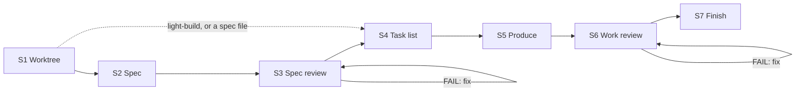
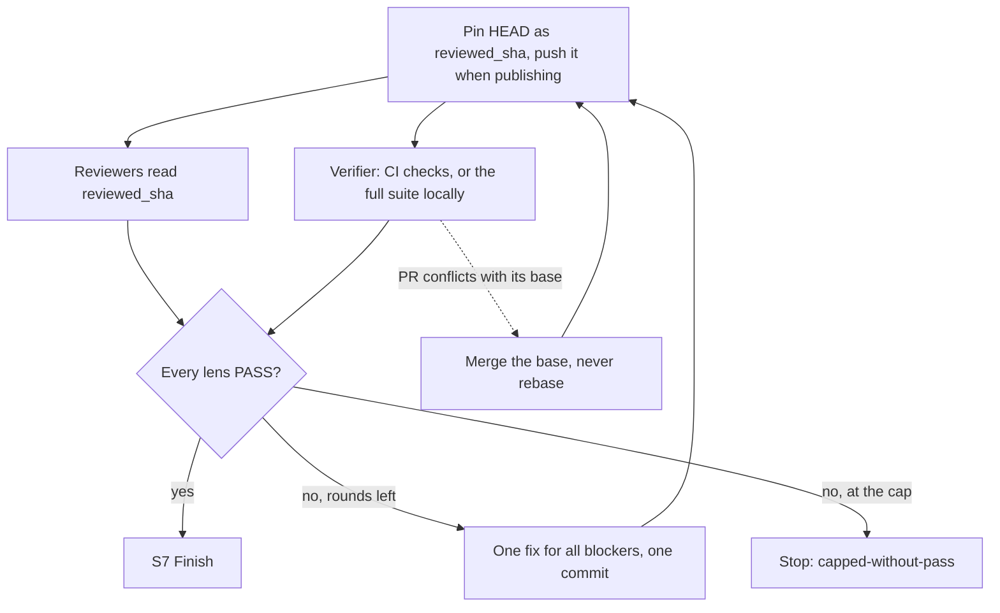

<div align="center">

#  Claude Autopilot

[English](../../README.md) · [中文](README.zh-CN.md) · [日本語](README.ja.md) · [한국어](README.ko.md) · [Español](README.es.md) · **Français** · [Português](README.pt.md)

</div>

*Ceci est une traduction ; la version de référence est le README en anglais.*

Un plugin pour Claude Code et Codex qui transforme un requirement en une git branch prête à être relue,
sans rien vous demander. Il réalise le travail lui-même (code, docs, designs, données, plans),
des agents reviewer indépendants le jugent, et il corrige jusqu'à ce qu'ils valident tous. Il ne fait jamais de merge.

> Statut : **v1.10.0**

## Installation

Dans Claude Code, ce dépôt est sa propre marketplace :

```
/plugin marketplace add https://github.com/ophis/claude-autopilot.git
/plugin install autopilot@claude-autopilot
```

`ophis/claude-autopilot`, un chemin local ou le menu `/plugin` fonctionnent aussi. Les versions suivent un
semver explicite (actuellement `1.10.0`). Pour mettre à jour, lancez `/plugin marketplace update claude-autopilot`,
puis de nouveau la ligne d'installation. Aucun autre plugin n'est nécessaire.

**Codex.** Invoquez la skill `autopilot:build` ou `autopilot:light-build` avec votre requirement, ou demandez à
Codex d'exécuter le chemin absolu de `skills/build/SKILL.md` ou `skills/light-build/SKILL.md` d'un checkout.
Nécessite la prise en charge des subagents. Les reviewers héritent du modèle de la session. Pas encore de
manifest de marketplace pour Codex.

## Utilisation

```
/autopilot:build add a function add(a,b) with a passing unit test
/autopilot:build path/to/spec.md
/autopilot:light-build add a --json flag to the status command
```

Attendez-vous à un nouveau worktree et une nouvelle branch, des boucles de revue qui se terminent par
`VERDICT: PASS`, des tests réellement exécutés, un commit par task et par round de correction, un rapport final,
et aucun merge. Avec un fichier de spec autonome, build saute S2 et S3. Pour itérer, lancez le requirement suivant
depuis la branch de la run terminée. Elle poursuit cette branch, avec son propre plan doc, une revue limitée à ses
nouveaux commits, et la même PR.

|  | `build` | `light-build` |
| --- | --- | --- |
| Étapes | S1–S7 | S1, S4–S7 |
| Spec | rédigée (S2), relue (S3) | le requirement tient lieu de spec |
| Panel S6 | toutes les lenses core, plus les optional qui correspondent au changement | fixe : correctness, requirement-fidelity, doc, verification |
| Re-review S6 | les lenses en échec, plus toutes les core | les lenses en échec, plus le verifier, plus correctness après un FAIL du verifier |
| Plafond | 3 rounds par phase de revue, modifiable dans le requirement | 3 rounds |
| Pour | le travail complexe | les tâches simples, ou l'autonomie sans la rigueur d'une spec |

light-build ne filtre pas le périmètre : il exécute ce que vous lui donnez. Le choix de la skill vous revient.

Deux skills plus petites fonctionnent seules ou au sein d'une autre skill :

```
/autopilot:review doc=path/to/prd.md requirement=path/to/request.md
/autopilot:council requirement=path/to/request.md <question and its options>
```

`review` relit un document au regard des propres mots de son auteur, et le corrige jusqu'à ce que les reviewers
valident ou jusqu'à 3 rounds, avec ou sans dépôt git ; `lenses=<dir>` substitue vos propres reviewers. `council`
recueille des choix indépendants face à une bifurcation : 2 à 4 subagents tout neufs ne voient que la question,
le requirement, les documents qu'il cite et le code en lecture seule.

## Déroulement d'une run



| Étape | Ce qui se passe |
| --- | --- |
| S1 Worktree | Reste sur toute branch autre que `main`, `master` ou celle par défaut d'origin. Sinon, crée un worktree et une branch `<prefix>-<slug>`, le préfixe étant l'ID du ticket pour un travail sur un seul ticket, sinon `autopilot`. Crée le plan doc et décide comment publier. |
| S2 Spec | Rédige la spec à partir du requirement et du code concerné. `check-spec.py` vérifie ses sections et que chaque critère d'acceptation a un test ou une vérification. |
| S3 Spec review | Boucle de revue sur la spec. Chaque re-review couvre toute la spec avec le panel complet. |
| S4 Task list | Sans code. Chaque task est un commit réversible : fichiers, interfaces entre tasks, tests à écrire d'abord, vérifications qu'elle lance, message de commit. La commande de verify complète figure au-dessus des tasks, avec les checks CI qui lancent ses tests lors d'une publication. |
| S5 Produce | Implémente les tasks dans l'ordre : les nouveaux tests échouent d'abord, puis le code, puis des vérifications limitées aux fichiers modifiés, puis un commit. Peut confier une task autonome à un producer tout neuf. Pas de revue par task. |
| S6 Work review | Boucle de revue sur le travail à un commit épinglé. Chaque round de correction est un commit `fix(r<N>)`. |
| S7 Finish | Rapport et options d'intégration, dont un squash merge. Copie les plan docs vers l'emplacement des plans du projet si son AGENTS.md ou CLAUDE.md en désigne un. |

### Un round de work review



Les rounds sont groupés : tous les verdicts, puis une correction, puis une re-review. Seuls les verdicts des
reviewers décident, dans la grammaire stricte `VERDICT / BLOCKING / NON-BLOCKING` ; l'orchestrator n'en
renverse jamais un. Une commande de test qui a exécuté 0 test échoue.

## CI et pull requests

Un dépôt doté d'une CI n'exécute jamais sa suite complète en local tant que la CI peut le faire. La run publie
sa branch en PR brouillon (draft), et le verifier lit les checks CI du commit relu pendant que les autres
reviewers lisent le code.

| `publish` | Quand | Pousse | À la fin |
| --- | --- | --- | --- |
| `pr` | le requirement demande une PR | chaque commit de task et chaque pin de S6 | build a publié la spec relue en commentaire ; le rapport va dans la description de la PR ; PR marquée ready |
| `ci` | un workflow `pull_request` existe et `gh` est authentifié pour l'hôte d'origin | chaque pin de S6 | une PR draft, que vous ou l'appelant reprenez |
| `none` | sinon, ou si un push est refusé en `ci` | rien | pas de PR ; vérifications lancées en local |

- Une PR ouverte sur la branch est reprise. Une PR déjà ready repasse en draft pendant la run et redevient ready
  à la convergence, pour que personne ne la fusionne en pleine revue.
- S4 nomme les checks CI qui lancent les tests. S'il n'y en a aucun, la vérification se fait en local.
- Avant de lancer un round de revue, la run consulte la PR pendant 20 secondes au plus. Un conflit de merge, ou
  une CI déjà en échec pour le commit épinglé, est corrigé avant qu'un reviewer ne tourne ; une CI rouge compte
  quand même comme un round. Une CI encore en cours ne retient jamais le round : le verifier l'attend en même
  temps que les autres reviewers.
- En mode `pr`, avant de pousser chaque task après la première, la run consulte la CI du push précédent, qui a
  tourné pendant qu'elle écrivait la task, et corrige sur-le-champ un résultat rouge ou un conflit, pour ne pas
  y perdre un round de revue.
- Un échec de CI entre dans la boucle de correction comme tout autre blocker.
- Une CI toujours inachevée une heure après le premier coup d'œil du verifier arrête la run. Elle ne se rabat
  jamais sur une suite complète en local.

## Décisions et arrêts

À une vraie bifurcation (des compromis nettement différents, ou un choix coûteux à défaire), la run lance le
council (`skills/council`) : elle consigne son propre choix, 2 à 4 subagents tout neufs répondent à partir de la
question, du requirement, des documents qu'il cite et du code en lecture seule, puis elle décide et consigne le
décompte. Un producer délégué face à une bifurcation renvoie plutôt un marqueur `FORK:`, et l'orchestrator
décide puis le relance.

Chaque run se termine par un unique bloc JSON `autopilot-result` délimité, pour qu'un appelant lise le
résultat sans analyser de prose :

```autopilot-result
{ "status": "converged", "branch": "autopilot-add-json-flag", "base_ref": "<sha>", "head": "<sha>", "pr": "", "blockers": [], "reason": "" }
```

| `status` | Quand | `reason` |
| --- | --- | --- |
| `converged` | toutes les lenses ont validé et S7 a tourné | vide |
| `capped-without-pass` | une boucle de revue a atteint son plafond | `oscillation`, `unfixable` ou `requirements-conflict` |
| `stopped` | une opération destructive (force-push, écriture hors du worktree, réécriture d'historique au-delà de la branch, rm ou reset de travail non commité) sans approbation automatique (Claude : Auto Mode) | `destructive-op` |
| `stopped` | un échec de phase ou une capacité manquante après une nouvelle tentative, CI ayant dépassé son délai comprise | `phase-failure` |
| `stopped` | un requirement qui se contredit | `root-contradiction` |

`pr` est l'URL de la PR de la run, en draft quand `publish=ci`. `blockers` liste les éléments blocking encore
ouverts quand la run n'a pas convergé.

## L'appeler depuis un workflow

Les deux surfaces sont des skills : une autre skill ou un workflow peut donc les appeler par leur nom, comme
`review` et `council` seules. Une run imbriquée reste sur la branch de l'appelant, sauf s'il s'agit d'une branch
par défaut ; elle crée alors son propre worktree. Ses docs sont nommés par requirement, donc les runs n'entrent
pas en collision. L'appelant intègre la branch renvoyée, lue dans le bloc `autopilot-result`.

## État et reprise

Chaque run conserve son état dans un seul plan doc ignoré, `.autopilot/<slug>-plan.md` dans son worktree
(build ajoute un spec doc à côté) : la commande de verify, une ligne `RESUME:`, le journal de progression,
les éléments de revue, des Notes sur les faits du code et la task list. Après une compaction du contexte, la
run se reconstruit à partir de ce fichier et de `git log`. Relancer le même requirement reprend une run inachevée.

## Review roster (`agents/`)

Chaque reviewer a une seule lens. Les lenses `core` d'une phase tournent toujours ; une lens `optional` tourne
quand son `applies_to` correspond aux mots-clés de la spec (S3) ou aux chemins modifiés (S6). Les reviewers
ordinaires sont en lecture seule et ne lancent jamais la suite complète.

| Fichier | Lens | Phase | Niveau |
| --- | --- | --- | --- |
| `reviewer-contract.md` | Modèle de rédaction intégré aux reviewers ordinaires (jamais lancé) ; le verification reviewer a un contrat d'exécution dédié |  |  |
| `spec-fitness-reviewer.md` | Adéquation de la spec : lacunes, ambiguïtés, périmètre, testabilité | spec | core |
| `architecture-reviewer.md` | Structure, frontières, couplage, extensibilité | both | spec : core. work : optional, quand un fichier est ajouté, supprimé, renommé ou copié (`@structural`) |
| `correctness-reviewer.md` | Logique, cas limites et aux bornes, chemins d'erreur | work | core |
| `requirement-fidelity-reviewer.md` | Le requirement et la spec réalisés, sans rien de manquant, de dévié ou d'ajouté | work | core |
| `doc-reviewer.md` | Les docs du dépôt que le changement a rendues fausses ; les modifications de docs gonflées | work | core |
| `verification-reviewer.md` | Vérifications complètes au SHA relu, en local ou via la CI : commandes, codes de sortie, nombres de tests et d'échecs | work | core |
| `code-quality-reviewer.md` | Lisibilité, nommage, duplication, code mort, complexité, commentaires | work | optional : fichiers de code |
| `test-reviewer.md` | Les tests vérifient la spec et couvrent le code nouveau ou modifié | work | optional : fichiers de code ou de test |
| `performance-reviewer.md` | Complexité, N+1, allocations, fuites, points chauds | work | optional : fichiers de code |
| `security-reviewer.md` | Autorisations, validation des entrées, secrets, injection, chaîne d'approvisionnement | both | optional : signaux d'authentification, d'entrée, de réseau, d'E/S, de dépendances ou de cryptographie |

`scripts/select-panel.py` construit le panel de build à partir du frontmatter de chaque fichier
(`lens`, `phase`, `tier`, `applies_to`) : une nouvelle lens, c'est un nouveau fichier. build lance toutes les
lenses core et n'écarte une optional marginale qu'avec une raison consignée. `review` accepte aussi un dossier
externe de reviewers rédigés selon `reviewer-contract.md` ; ils tournent comme agents génériques. Sur Claude Code,
chaque reviewer tourne en tant que `autopilot:<name>` avec le `model:` et l'`effort:` de son frontmatter ; sur
Codex, il hérite du modèle de la session. Une lens relue repart de zéro avec ses éléments précédents et, en S6,
le diff de la correction.

### Plugin workflow (`workflows/review-round.js`)

Le transport par défaut d'un round, `Workflow({name: "autopilot:autopilot-review-round", args})`, lance tous
les membres en parallèle et valide chaque verdict par un schema. Sans Workflow, les skills lancent les reviewers
nativement.

- Entrée `args` : `{phase, members: [{agent, subagent_type, prompt}]}`.
- Sortie : `{phase, verdicts: [{agent, VERDICT, BLOCKING, NON_BLOCKING, synthetic}]}`, dans l'ordre des membres.
  `VERDICT` vaut `PASS` seulement si le reviewer a dit `PASS` sans aucun `BLOCKING`. Un membre sans verdict
  devient `FAIL` avec `synthetic: true` ; les skills le relancent une fois nativement.

## Développement local

```
claude --plugin-dir /path/to/claude-autopilot              # load the working copy
/reload-plugins                                            # after an edit, in session
claude plugin validate /path/to/claude-autopilot --strict  # manifests and frontmatter
python3 scripts/lint-roster.py                             # after editing agents/
python3 tests/test_scripts.py                              # helper-script tests, stdlib only
```

Lancez aussi le [smoke protocol](../../CONTRIBUTING.md#smoke-protocol). Les docs de développement de chaque build
vont dans `dev-docs/<date>-<slug>-{spec,plan}.md`, ignoré par git.

Le dépôt est à la fois la marketplace et le plugin :

```
claude-autopilot/
├── .claude-plugin/
│   ├── plugin.json               # name: autopilot (version 1.10.0)
│   └── marketplace.json          # name: claude-autopilot, plugins:[{source:"./"}]
├── skills/
│   ├── build/SKILL.md            # /autopilot:build
│   ├── build/spec.md             # spec-writing guide for S2
│   ├── build/scripts/check-spec.py     # S2 spec structure and AC coverage
│   ├── light-build/SKILL.md      # /autopilot:light-build
│   ├── review/SKILL.md           # /autopilot:review: review one document
│   └── council/SKILL.md          # /autopilot:council: independent picks at a fork
├── references/
│   ├── autopilot-common.md       # run rules build and light-build share
│   └── review-round.md           # how a review round runs and loops
├── scripts/
│   ├── select-panel.py           # (phase, signals) → panel JSON
│   ├── ci-verdict.py             # one commit's CI checks → verifier verdict
│   ├── pr.py                     # draft PR start / push / spec / finish
│   ├── resolve-branch.py         # S1: resume / stay / reuse / create / stop
│   ├── _frontmatter.py           # parser shared by the selector and the roster lint
│   └── lint-roster.py            # roster lint
├── workflows/
│   └── review-round.js           # plugin workflow: one parallel review round
├── agents/                       # review roster
│   ├── reviewer-contract.md      # authoring template, inlined into ordinary reviewers
│   └── *-reviewer.md             # one lens each
├── tests/
│   └── test_scripts.py           # stdlib unittest for the scripts
├── AGENTS.md                     # contributor guidance for Claude Code and Codex
└── README.md
```
