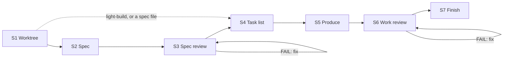
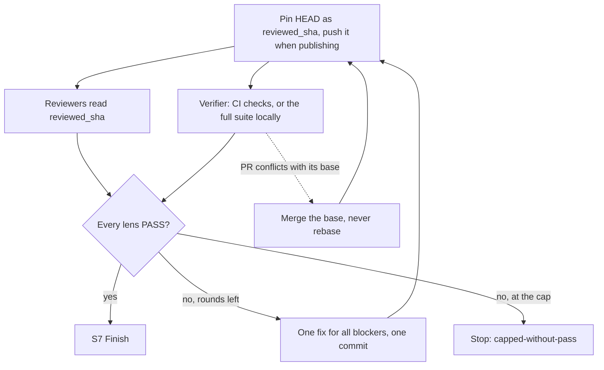

<div align="center">

#  Claude Autopilot

[English](../../README.md) · [中文](README.zh-CN.md) · **日本語** · [한국어](README.ko.md) · [Español](README.es.md) · [Français](README.fr.md) · [Português](README.pt.md)

</div>

*これは翻訳です。正式な内容は英語版 README を参照してください。*

1 つの requirement を、あなたに何も尋ねることなく、レビュー可能な git branch に変える
Claude Code と Codex のプラグインです。作業そのもの（コード、ドキュメント、デザイン、データ、計画）は自分で行い、
独立した reviewer agent がそれを判定し、全員が合格するまで修正を続けます。マージは決して行いません。

> ステータス: **v1.10.0**

## インストール

Claude Code では、このリポジトリ自体が marketplace です:

```
/plugin marketplace add https://github.com/ophis/claude-autopilot.git
/plugin install autopilot@claude-autopilot
```

`ophis/claude-autopilot`、ローカルパス、`/plugin` メニューでもインストールできます。リリースは明示的な
semver を使います（現在は `1.10.0`）。更新するには `/plugin marketplace update claude-autopilot` を実行し、
もう一度インストールコマンドを実行します。他のプラグインは不要です。

**Codex。** requirement を添えて `autopilot:build` または `autopilot:light-build` skill を呼び出すか、
checkout 内の `skills/build/SKILL.md` または `skills/light-build/SKILL.md` の絶対パスを Codex に実行させます。
subagent のサポートが必要です。reviewer はセッションのモデルを引き継ぎます。Codex 用の marketplace manifest はまだありません。

## 使い方

```
/autopilot:build add a function add(a,b) with a passing unit test
/autopilot:build path/to/spec.md
/autopilot:light-build add a --json flag to the status command
```

得られるもの: 新しい worktree と branch、`VERDICT: PASS` で終わるレビューループ、実際に実行されたテスト、
task ごと・修正ラウンドごとに 1 つの commit、最終レポート、そしてマージなし。自己完結した spec ファイルを渡すと、
build は S2 と S3 を飛ばします。続けて反復するには、完了した run の branch から次の requirement を実行します。
その branch を引き継ぎ、専用の plan doc を持ち、新しい commit だけをレビューし、同じ PR を使います。

|  | `build` | `light-build` |
| --- | --- | --- |
| ステップ | S1–S7 | S1、S4–S7 |
| Spec | 作成（S2）、レビュー（S3） | requirement がそのまま spec |
| S6 panel | すべての core lens と、変更に一致する optional lens | 固定: correctness、requirement-fidelity、doc、verification |
| S6 re-review | 失敗した lens とすべての core lens | 失敗した lens と verifier、verifier が FAIL した後は correctness も |
| 上限 | レビューフェーズごとに 3 ラウンド、requirement で変更可能 | 3 ラウンド |
| 向いている作業 | 複雑な作業 | 単純なタスク、または spec の厳密さなしで自律的に進めたいとき |

light-build はスコープを制限しません。渡されたものは何でも実行します。どの skill を選ぶかはあなた次第です。

単独でも、他の skill の中でも動く小さな skill が 2 つあります:

```
/autopilot:review doc=path/to/prd.md requirement=path/to/request.md
/autopilot:council requirement=path/to/request.md <question and its options>
```

`review` は 1 つのドキュメントを作者自身の言葉と照らし合わせてレビューし、reviewer が合格するか 3 ラウンドに達するまで
修正します。git リポジトリの有無は問いません。`lenses=<dir>` で独自の reviewer に差し替えられます。`council` は分岐点で
独立した選択を集めます: 2〜4 体の新しい subagent が見るのは、質問、requirement、そこで挙げられたドキュメント、読み取り専用のコードだけです。

## run の流れ



| ステップ | 内容 |
| --- | --- |
| S1 Worktree | `main`、`master`、origin のデフォルト以外の branch ならそこに留まります。それ以外では worktree と `<prefix>-<slug>` という branch を作ります。prefix は 1 チケットの作業ならチケット ID、それ以外は `autopilot` です。plan doc を作成し、公開方法を決めます。 |
| S2 Spec | requirement とそれが触れるコードから spec を書きます。`check-spec.py` がセクションと、すべての受け入れ基準にテストかチェックがあることを確認します。 |
| S3 Spec review | spec に対するレビューループ。re-review のたびにフル panel が spec 全体をレビューします。 |
| S4 Task list | コードは書きません。各 task は元に戻せる 1 つの commit です: ファイル、task 間のインターフェース、先に書くテスト、実行するチェック、commit メッセージ。完全な verify コマンドが task の上に置かれ、公開時にはそのテストを実行する CI チェックも添えられます。 |
| S5 Produce | task を順に実装します: 新しいテストをまず失敗させ、次にコード、変更したファイルだけを対象にしたチェック、そして commit。自己完結した task を新しい producer に渡すこともあります。task ごとのレビューはありません。 |
| S6 Work review | 固定した commit で作業をレビューするループ。各修正ラウンドは 1 つの `fix(r<N>)` commit です。 |
| S7 Finish | レポートと統合の選択肢（squash merge を含む）。プロジェクトの AGENTS.md または CLAUDE.md が計画の保存場所を指定していれば、plan doc をそこにコピーします。 |

### work review の 1 ラウンド



ラウンドはまとめて進みます: すべての verdict を集め、1 回修正し、1 回 re-review します。判定するのは reviewer の
verdict だけで、厳密な `VERDICT / BLOCKING / NON-BLOCKING` の文法に従います。orchestrator が verdict を覆すことはありません。
テストを 0 件しか実行しなかったテストコマンドは失敗扱いです。

## CI と pull request

CI のあるリポジトリでは、CI で実行できる限りフルスイートをローカルで実行しません。run は branch を draft PR として公開し、
verifier はレビュー対象の commit の CI チェックを読み、他の reviewer はコードを読みます。

| `publish` | 条件 | push するもの | 終了時 |
| --- | --- | --- | --- |
| `pr` | requirement が PR を求めている | 各 task commit と各 S6 pin | build はレビュー済み spec をコメントとして投稿済み。レポートは PR 本文に入り、PR は ready になる |
| `ci` | `pull_request` workflow があり、`gh` が origin のホストで認証済み | 各 S6 pin | draft PR。あなたか呼び出し側が引き継ぐ |
| `none` | それ以外、または `ci` で push が拒否された場合 | なし | PR なし。チェックはローカルで実行 |

- branch 上の open PR は引き継がれます。ready の PR は run の間 draft に戻され、収束すると ready に戻るので、
  レビュー途中で誰かがマージすることはありません。
- S4 はテストを実行する CI チェックを明記します。該当するものがなければ、verification はローカルで実行されます。
- レビューラウンドを開始する前に、run は最大 20 秒 PR を確認します。マージコンフリクトや、固定した commit の CI が
  すでに失敗している場合は、reviewer が動く前に修正します。赤い CI もラウンドとして数えます。実行中の CI がラウンドを
  止めることはありません: verifier が他の reviewer と並行して待ちます。
- `pr` モードでは、2 つ目以降の task を push する前に、run は直前の push の CI（task を書いている間に走っていたもの）を確認し、
  赤い結果やコンフリクトをその場で修正します。こうしてレビューラウンドを無駄にしません。
- CI の失敗は他の blocker と同じく修正ループに入ります。
- verifier が最初に確認してから 1 時間たっても CI が終わらなければ、run は停止します。ローカルのフルスイートに切り替えることはありません。

## 判断と停止

本当の分岐点（トレードオフが大きく異なる、または元に戻すのが高くつく選択）では、run は council（`skills/council`）を実行します:
まず自分の選択を記録し、2〜4 体の新しい subagent が質問、requirement、そこで挙げられたドキュメント、読み取り専用のコードから回答し、
最後に判断して集計を記録します。委任された producer が分岐点に来た場合は、代わりに `FORK:` マーカーを返し、
orchestrator が判断して再度送り出します。

すべての run は 1 つのフェンス付き `autopilot-result` JSON ブロックで終わるので、呼び出し側は文章を解析せずに結果を読めます:

```autopilot-result
{ "status": "converged", "branch": "autopilot-add-json-flag", "base_ref": "<sha>", "head": "<sha>", "pr": "", "blockers": [], "reason": "" }
```

| `status` | 条件 | `reason` |
| --- | --- | --- |
| `converged` | すべての lens が合格し、S7 が実行された | 空 |
| `capped-without-pass` | レビューループが上限に達した | `oscillation`、`unfixable`、`requirements-conflict` のいずれか |
| `stopped` | 自動承認（Claude: Auto Mode）のない破壊的操作（force-push、worktree 外への書き込み、branch を超える履歴の書き換え、未コミット作業の rm や reset） | `destructive-op` |
| `stopped` | 1 回リトライしてもフェーズが失敗する、または機能が足りない（CI の期限切れを含む） | `phase-failure` |
| `stopped` | 自己矛盾した requirement | `root-contradiction` |

`pr` は run の PR URL で、`publish=ci` のときは draft です。収束しなかった場合、`blockers` に未解決の blocking 項目が並びます。

## workflow から呼び出す

どちらの入口も skill なので、他の skill や workflow から名前で呼び出せます。`review` と `council` を単独で呼ぶのと同じです。
ネストした run は呼び出し側の branch に留まりますが、それがデフォルト branch の場合は自分の worktree を作ります。
ドキュメントは requirement ごとに名前が付くので、run 同士は衝突しません。呼び出し側は `autopilot-result` ブロックから
返された branch を読み取り、統合します。

## 状態と再開

各 run は状態を 1 つの無視される plan doc、つまり worktree 内の `.autopilot/<slug>-plan.md` に保持します（build はその隣に spec doc を加えます）:
verify コマンド、`RESUME:` 行、進捗ログ、レビュー項目、コードベースの事実を記録した Notes、task list です。コンテキストの圧縮後、
run はこれと `git log` から復元します。同じ requirement をもう一度実行すると、未完了の run が再開されます。

## Review roster（`agents/`）

各 reviewer の lens は 1 つです。フェーズの `core` lens は常に実行され、`optional` lens は `applies_to` が spec のキーワード（S3）
または変更されたパス（S6）に一致したときに実行されます。通常の reviewer は読み取り専用で、フルスイートを実行することはありません。

| ファイル | Lens | フェーズ | 層 |
| --- | --- | --- | --- |
| `reviewer-contract.md` | 通常の reviewer に埋め込まれる作成用テンプレート（送り出されない）。verification reviewer には専用の実行契約がある |  |  |
| `spec-fitness-reviewer.md` | spec の適合性: 抜け、曖昧さ、スコープ、テスト可能性 | spec | core |
| `architecture-reviewer.md` | 構造、境界、結合、拡張性 | both | spec: core。work: optional、ファイルが追加・削除・リネーム・コピーされたとき（`@structural`） |
| `correctness-reviewer.md` | ロジック、エッジケースと境界条件、エラーパス | work | core |
| `requirement-fidelity-reviewer.md` | requirement と spec が実装され、欠落・逸脱・追加がない | work | core |
| `doc-reviewer.md` | 変更によって事実と合わなくなったリポジトリ内のドキュメント。肥大化したドキュメント編集 | work | core |
| `verification-reviewer.md` | レビュー対象の SHA でのフルチェック（ローカルまたは CI）: コマンド、終了コード、テスト数と失敗数 | work | core |
| `code-quality-reviewer.md` | 可読性、命名、重複、デッドコード、複雑さ、コメント | work | optional: コードファイル |
| `test-reviewer.md` | テストが spec をアサートし、新規・変更コードをカバーしている | work | optional: コードまたはテストファイル |
| `performance-reviewer.md` | 計算量、N+1、メモリ確保、リーク、ホットスポット | work | optional: コードファイル |
| `security-reviewer.md` | 認可、入力検証、シークレット、インジェクション、サプライチェーン | both | optional: 認証、入力、ネットワーク、I/O、依存関係、暗号のシグナル |

`scripts/select-panel.py` は各ファイルの frontmatter（`lens`、`phase`、`tier`、`applies_to`）から build の panel を組むので、
新しい lens は新しいファイルを 1 つ足すだけです。build はすべての core lens を実行し、効果の薄い optional lens は理由を記録したときだけ外します。
`review` は `reviewer-contract.md` に沿って書かれた外部の reviewer フォルダも受け付け、それらは汎用 agent として実行されます。Claude Code では
各 reviewer は `autopilot:<name>` として、frontmatter の `model:` と `effort:` で実行されます。Codex ではセッションのモデルを引き継ぎます。
re-review される lens は、前回のレビュー項目と（S6 では）修正の diff を持って新たに始まります。

### Plugin workflow（`workflows/review-round.js`）

1 ラウンドのデフォルトのトランスポート `Workflow({name: "autopilot:autopilot-review-round", args})` は、全メンバーを並列に実行し、
各 verdict をスキーマで検証します。Workflow がなければ、skill はネイティブに送り出します。

- 入力 `args`: `{phase, members: [{agent, subagent_type, prompt}]}`。
- 出力: `{phase, verdicts: [{agent, VERDICT, BLOCKING, NON_BLOCKING, synthetic}]}`（メンバー順）。`VERDICT` が `PASS` になるのは、
  reviewer が `PASS` と答え、`BLOCKING` がないときだけです。verdict を返さなかったメンバーは `synthetic: true` 付きの `FAIL` になり、
  skill がネイティブに 1 回だけ再送します。

## ローカル開発

```
claude --plugin-dir /path/to/claude-autopilot              # load the working copy
/reload-plugins                                            # after an edit, in session
claude plugin validate /path/to/claude-autopilot --strict  # manifests and frontmatter
python3 scripts/lint-roster.py                             # after editing agents/
python3 tests/test_scripts.py                              # helper-script tests, stdlib only
```

[smoke protocol](../../CONTRIBUTING.md#smoke-protocol) も実行してください。build ごとの開発ドキュメントは、gitignore された
`dev-docs/<date>-<slug>-{spec,plan}.md` に置きます。

このリポジトリは marketplace であり、プラグインでもあります:

```
claude-autopilot/
├── .claude-plugin/
│   ├── plugin.json               # name: autopilot (version 1.10.0)
│   └── marketplace.json          # name: claude-autopilot, plugins:[{source:"./"}]
├── skills/
│   ├── build/SKILL.md            # /autopilot:build
│   ├── build/spec.md             # spec-writing guide for S2
│   ├── build/scripts/check-spec.py     # S2 spec structure and AC coverage
│   ├── light-build/SKILL.md      # /autopilot:light-build
│   ├── review/SKILL.md           # /autopilot:review: review one document
│   └── council/SKILL.md          # /autopilot:council: independent picks at a fork
├── references/
│   ├── autopilot-common.md       # run rules build and light-build share
│   └── review-round.md           # how a review round runs and loops
├── scripts/
│   ├── select-panel.py           # (phase, signals) → panel JSON
│   ├── ci-verdict.py             # one commit's CI checks → verifier verdict
│   ├── pr.py                     # draft PR start / push / spec / finish
│   ├── resolve-branch.py         # S1: resume / stay / reuse / create / stop
│   ├── _frontmatter.py           # parser shared by the selector and the roster lint
│   └── lint-roster.py            # roster lint
├── workflows/
│   └── review-round.js           # plugin workflow: one parallel review round
├── agents/                       # review roster
│   ├── reviewer-contract.md      # authoring template, inlined into ordinary reviewers
│   └── *-reviewer.md             # one lens each
├── tests/
│   └── test_scripts.py           # stdlib unittest for the scripts
├── AGENTS.md                     # contributor guidance for Claude Code and Codex
└── README.md
```
