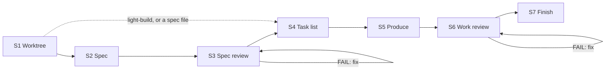
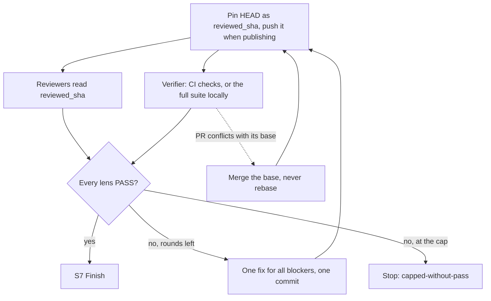

<div align="center">

#  Claude Autopilot

[English](../../README.md) · [中文](README.zh-CN.md) · [日本語](README.ja.md) · **한국어** · [Español](README.es.md) · [Français](README.fr.md) · [Português](README.pt.md)

</div>

*이 문서는 번역본입니다. 공식 버전은 영어 README입니다.*

requirement 하나를 아무것도 묻지 않고 리뷰할 준비가 된 git branch로 바꿔 주는 Claude Code 및 Codex 플러그인입니다.
작업 자체(코드, 문서, 디자인, 데이터, 계획)는 직접 하고, 독립된 reviewer agent가 이를 판정하며, 모두 통과할 때까지 고칩니다.
병합은 절대 하지 않습니다.

> 상태: **v1.10.0**

## 설치

Claude Code에서는 이 저장소가 곧 marketplace입니다:

```
/plugin marketplace add https://github.com/ophis/claude-autopilot.git
/plugin install autopilot@claude-autopilot
```

`ophis/claude-autopilot`, 로컬 경로 또는 `/plugin` 메뉴로도 설치할 수 있습니다. 릴리스는 명시적인 semver를 씁니다
(현재 `1.10.0`). 업데이트하려면 `/plugin marketplace update claude-autopilot`을 실행한 뒤 설치 명령을 다시 실행하세요.
다른 플러그인은 필요 없습니다.

**Codex.** requirement와 함께 `autopilot:build` 또는 `autopilot:light-build` skill을 호출하거나, checkout에 있는
`skills/build/SKILL.md` 또는 `skills/light-build/SKILL.md`의 절대 경로를 Codex에게 실행하라고 하세요. subagent 지원이 필요합니다.
reviewer는 세션의 모델을 그대로 씁니다. Codex marketplace manifest는 아직 없습니다.

## 사용법

```
/autopilot:build add a function add(a,b) with a passing unit test
/autopilot:build path/to/spec.md
/autopilot:light-build add a --json flag to the status command
```

결과물: 새 worktree와 branch, `VERDICT: PASS`로 끝나는 리뷰 루프, 실제로 실행된 테스트, task마다 그리고 수정 라운드마다
commit 하나씩, 최종 보고서, 그리고 병합 없음. 자기 완결적인 spec 파일을 주면 build는 S2와 S3를 건너뜁니다. 반복하려면
끝난 run의 branch에서 다음 requirement를 실행하세요. 그 branch를 이어 가며, 자체 plan doc을 쓰고, 새 commit만 리뷰하고,
같은 PR을 사용합니다.

|  | `build` | `light-build` |
| --- | --- | --- |
| 단계 | S1–S7 | S1, S4–S7 |
| Spec | 작성(S2), 리뷰(S3) | requirement가 곧 spec |
| S6 panel | 모든 core lens, 그리고 변경에 해당하는 optional lens | 고정: correctness, requirement-fidelity, doc, verification |
| S6 re-review | 실패한 lens, 그리고 모든 core lens | 실패한 lens, verifier, verifier FAIL 후에는 correctness도 |
| 상한 | 리뷰 단계마다 3라운드, requirement에서 변경 가능 | 3라운드 |
| 적합한 작업 | 복잡한 작업 | 단순한 작업, 또는 spec의 엄격함 없이 자율적으로 진행하고 싶을 때 |

light-build는 범위를 제한하지 않습니다. 주는 것은 무엇이든 실행합니다. 어떤 skill을 고를지는 여러분의 몫입니다.

단독으로도, 다른 skill 안에서도 실행되는 작은 skill이 두 개 있습니다:

```
/autopilot:review doc=path/to/prd.md requirement=path/to/request.md
/autopilot:council requirement=path/to/request.md <question and its options>
```

`review`는 문서 하나를 작성자 본인의 말과 대조해 리뷰하고, reviewer가 통과하거나 3라운드가 될 때까지 고칩니다.
git 저장소가 있든 없든 동작합니다. `lenses=<dir>`로 여러분의 reviewer로 바꿀 수 있습니다. `council`은 갈림길에서 독립적인
선택을 받습니다: 새로 띄운 2–4개의 subagent는 질문, requirement, 거기에 언급된 문서, 읽기 전용 코드만 봅니다.

## run의 진행 방식



| 단계 | 하는 일 |
| --- | --- |
| S1 Worktree | `main`, `master`, origin의 기본 branch가 아니면 현재 branch에 머뭅니다. 그렇지 않으면 worktree와 `<prefix>-<slug>` branch를 만듭니다. prefix는 티켓 하나짜리 작업이면 티켓 ID, 아니면 `autopilot`입니다. plan doc을 만들고 게시 방식을 정합니다. |
| S2 Spec | requirement와 그것이 건드리는 코드를 바탕으로 spec을 씁니다. `check-spec.py`가 섹션을 확인하고, 모든 인수 기준에 테스트나 검사가 있는지 확인합니다. |
| S3 Spec review | spec에 대한 리뷰 루프. re-review마다 전체 panel이 spec 전체를 검토합니다. |
| S4 Task list | 코드는 쓰지 않습니다. 각 task는 되돌릴 수 있는 commit 하나입니다: 파일, task 간 인터페이스, 먼저 쓸 테스트, 실행할 검사, commit 메시지. 전체 verify 명령은 task 위에 두고, 게시할 때는 그 테스트를 실행하는 CI 검사도 함께 적습니다. |
| S5 Produce | task를 순서대로 구현합니다: 새 테스트가 먼저 실패하고, 그다음 코드, 변경된 파일만 다루는 검사, 그리고 commit. 자기 완결적인 task는 새 producer에게 맡길 수 있습니다. task별 리뷰는 없습니다. |
| S6 Work review | 고정된 commit에서 작업물을 리뷰하는 루프. 수정 라운드마다 `fix(r<N>)` commit 하나입니다. |
| S7 Finish | 보고서와 통합 옵션(squash merge 포함). 프로젝트의 AGENTS.md나 CLAUDE.md가 계획 문서 위치를 지정하면 plan doc을 그곳에 복사합니다. |

### work review 한 라운드



라운드는 일괄로 진행됩니다: 모든 verdict를 받고, 한 번 고치고, 한 번 re-review합니다. 결정은 오직 reviewer의 verdict가 하며,
엄격한 `VERDICT / BLOCKING / NON-BLOCKING` 문법을 따릅니다. orchestrator는 verdict를 뒤집지 않습니다. 테스트를 0개 실행한
테스트 명령은 실패로 처리합니다.

## CI와 pull request

CI가 있는 저장소는 CI가 실행할 수 있는 한 전체 테스트 스위트를 로컬에서 돌리지 않습니다. run은 branch를 draft PR로 게시하고,
verifier는 리뷰 대상 commit의 CI 검사를 읽으며, 다른 reviewer는 코드를 읽습니다.

| `publish` | 조건 | push 대상 | 종료 시 |
| --- | --- | --- | --- |
| `pr` | requirement가 PR을 요구할 때 | 각 task commit과 각 S6 pin | build가 리뷰된 spec을 댓글로 올려 둠. 보고서는 PR 본문에, PR은 ready로 표시 |
| `ci` | `pull_request` workflow가 있고 `gh`가 origin 호스트에 인증되어 있을 때 | 각 S6 pin | draft PR. 여러분이나 호출자가 이어받음 |
| `none` | 그 밖의 경우, 또는 `ci`에서 push가 거부된 경우 | 없음 | PR 없음. 검사는 로컬에서 실행 |

- branch에 열린 PR이 있으면 그것을 이어받습니다. ready 상태의 PR은 run 동안 draft로 되돌렸다가 수렴하면 다시 ready로 표시하므로,
  리뷰 도중 누군가 병합하는 일이 없습니다.
- S4는 테스트를 실행하는 CI 검사를 명시합니다. 그런 검사가 없으면 verification은 로컬에서 실행됩니다.
- 리뷰 라운드를 보내기 전에 run은 PR을 최대 20초 동안 확인합니다. 병합 충돌이나 고정된 commit의 CI가 이미 실패한 경우는
  reviewer가 실행되기 전에 고칩니다. 빨간 CI도 한 라운드로 셉니다. 아직 실행 중인 CI가 라운드를 붙잡지는 않습니다:
  verifier가 다른 reviewer와 함께 기다립니다.
- `pr` 모드에서는 첫 task 이후 각 task를 push하기 전에, run이 직전 push의 CI(task를 쓰는 동안 돌던 것)를 확인하고
  빨간 결과나 충돌을 그 자리에서 고칩니다. 그래서 리뷰 라운드를 쓰지 않습니다.
- CI 실패는 다른 blocker처럼 수정 루프에 들어갑니다.
- verifier가 처음 확인한 지 한 시간이 지나도 CI가 끝나지 않으면 run은 멈춥니다. 로컬 전체 스위트로 넘어가지 않습니다.

## 결정과 중단

진짜 갈림길(트레이드오프가 크게 다르거나 되돌리기 비싼 선택)에서 run은 council(`skills/council`)을 실행합니다:
먼저 자신의 선택을 기록하고, 새로 띄운 2–4개의 subagent가 질문, requirement, 거기에 언급된 문서, 읽기 전용 코드를 바탕으로 답한 뒤,
결정을 내리고 집계를 기록합니다. 위임된 producer가 갈림길을 만나면 대신 `FORK:` 마커를 반환하고, orchestrator가 결정한 뒤 다시 보냅니다.

모든 run은 펜스로 감싼 `autopilot-result` JSON 블록 하나로 끝나므로, 호출자는 산문을 파싱하지 않고도 결과를 읽을 수 있습니다:

```autopilot-result
{ "status": "converged", "branch": "autopilot-add-json-flag", "base_ref": "<sha>", "head": "<sha>", "pr": "", "blockers": [], "reason": "" }
```

| `status` | 조건 | `reason` |
| --- | --- | --- |
| `converged` | 모든 lens가 통과하고 S7이 실행됨 | 비어 있음 |
| `capped-without-pass` | 리뷰 루프가 상한에 도달함 | `oscillation`, `unfixable` 또는 `requirements-conflict` |
| `stopped` | 자동 승인(Claude: Auto Mode) 없는 파괴적 작업(force-push, worktree 밖 쓰기, branch를 넘어서는 히스토리 재작성, 커밋되지 않은 작업의 rm 또는 reset) | `destructive-op` |
| `stopped` | 한 번 재시도한 뒤에도 단계 실패나 기능 부족(CI 마감 초과 포함) | `phase-failure` |
| `stopped` | 스스로 모순되는 requirement | `root-contradiction` |

`pr`은 run의 PR URL이며, `publish=ci`일 때는 draft입니다. 수렴하지 못했을 때 `blockers`에 남은 blocking 항목이 나열됩니다.

## workflow에서 호출하기

두 진입점 모두 skill이므로, 다른 skill이나 workflow가 `review`와 `council`을 단독으로 부르듯이 이름으로 호출할 수 있습니다.
중첩된 run은 호출자의 branch에 머무르지만, 그것이 기본 branch라면 자체 worktree를 만듭니다. 문서 이름은 requirement마다 붙으므로
run끼리 충돌하지 않습니다. 호출자는 `autopilot-result` 블록에서 반환된 branch를 읽어 통합합니다.

## 상태와 재개

각 run은 상태를 무시되는 plan doc 하나, 즉 worktree 안의 `.autopilot/<slug>-plan.md`에 보관합니다(build는 그 옆에 spec doc을 추가합니다):
verify 명령, `RESUME:` 줄, 진행 로그, 리뷰 항목, 코드베이스 사실을 적은 Notes, task list입니다. 컨텍스트 압축 후 run은 이것과
`git log`로 다시 구성합니다. 같은 requirement를 다시 실행하면 끝나지 않은 run을 재개합니다.

## Review roster(`agents/`)

각 reviewer는 lens 하나를 가집니다. 한 단계의 `core` lens는 항상 실행되고, `optional` lens는 `applies_to`가 spec의 키워드(S3)
또는 변경된 경로(S6)와 일치할 때 실행됩니다. 일반 reviewer는 읽기 전용이며 전체 스위트를 실행하지 않습니다.

| 파일 | Lens | 단계 | 등급 |
| --- | --- | --- | --- |
| `reviewer-contract.md` | 일반 reviewer에 인라인되는 작성용 템플릿(보내지지 않음). verification reviewer는 전용 실행 계약을 가짐 |  |  |
| `spec-fitness-reviewer.md` | spec 적합성: 빈틈, 모호함, 범위, 테스트 가능성 | spec | core |
| `architecture-reviewer.md` | 구조, 경계, 결합도, 확장성 | both | spec: core. work: optional, 파일이 추가·삭제·이름 변경·복사될 때(`@structural`) |
| `correctness-reviewer.md` | 로직, 엣지 케이스와 경계 조건, 오류 경로 | work | core |
| `requirement-fidelity-reviewer.md` | requirement와 spec이 구현되었고 빠지거나, 벗어나거나, 더해진 것이 없음 | work | core |
| `doc-reviewer.md` | 변경 때문에 사실과 달라진 저장소 내 문서. 비대해진 문서 수정 | work | core |
| `verification-reviewer.md` | 리뷰 대상 SHA에서의 전체 검사(로컬 또는 CI): 명령, 종료 코드, 테스트 수와 실패 수 | work | core |
| `code-quality-reviewer.md` | 가독성, 이름, 중복, 죽은 코드, 복잡도, 주석 | work | optional: 코드 파일 |
| `test-reviewer.md` | 테스트가 spec을 검증하고 새로 추가되거나 바뀐 코드를 다룸 | work | optional: 코드 또는 테스트 파일 |
| `performance-reviewer.md` | 복잡도, N+1, 메모리 할당, 누수, 핫스팟 | work | optional: 코드 파일 |
| `security-reviewer.md` | 인가, 입력 검증, 시크릿, 인젝션, 공급망 | both | optional: 인증, 입력, 네트워크, I/O, 의존성 또는 암호화 신호 |

`scripts/select-panel.py`는 각 파일의 frontmatter(`lens`, `phase`, `tier`, `applies_to`)로 build의 panel을 구성하므로,
새 lens는 새 파일 하나입니다. build는 모든 core lens를 실행하고, 별 효과 없는 optional lens는 이유를 기록할 때만 뺍니다.
`review`는 `reviewer-contract.md`에 맞춰 작성된 외부 reviewer 폴더도 받으며, 이들은 범용 agent로 실행됩니다. Claude Code에서는
각 reviewer가 frontmatter의 `model:`과 `effort:`로 `autopilot:<name>`으로 실행되고, Codex에서는 세션의 모델을 그대로 씁니다.
re-review되는 lens는 이전 리뷰 항목과 (S6에서는) 수정 diff를 가지고 새로 시작합니다.

### Plugin workflow(`workflows/review-round.js`)

한 라운드의 기본 전송 방식인 `Workflow({name: "autopilot:autopilot-review-round", args})`는 모든 멤버를 병렬로 실행하고
각 verdict를 스키마로 검증합니다. Workflow가 없으면 skill이 네이티브로 보냅니다.

- 입력 `args`: `{phase, members: [{agent, subagent_type, prompt}]}`.
- 출력: `{phase, verdicts: [{agent, VERDICT, BLOCKING, NON_BLOCKING, synthetic}]}`, 멤버 순서대로. `VERDICT`는 reviewer가
  `PASS`라고 했고 `BLOCKING`이 없을 때만 `PASS`입니다. verdict가 없는 멤버는 `synthetic: true`와 함께 `FAIL`이 되며,
  skill이 네이티브로 한 번 다시 보냅니다.

## 로컬 개발

```
claude --plugin-dir /path/to/claude-autopilot              # load the working copy
/reload-plugins                                            # after an edit, in session
claude plugin validate /path/to/claude-autopilot --strict  # manifests and frontmatter
python3 scripts/lint-roster.py                             # after editing agents/
python3 tests/test_scripts.py                              # helper-script tests, stdlib only
```

[smoke protocol](../../CONTRIBUTING.md#smoke-protocol)도 실행하세요. build별 개발 문서는 gitignore된
`dev-docs/<date>-<slug>-{spec,plan}.md`에 둡니다.

이 저장소는 marketplace이자 플러그인입니다:

```
claude-autopilot/
├── .claude-plugin/
│   ├── plugin.json               # name: autopilot (version 1.10.0)
│   └── marketplace.json          # name: claude-autopilot, plugins:[{source:"./"}]
├── skills/
│   ├── build/SKILL.md            # /autopilot:build
│   ├── build/spec.md             # spec-writing guide for S2
│   ├── build/scripts/check-spec.py     # S2 spec structure and AC coverage
│   ├── light-build/SKILL.md      # /autopilot:light-build
│   ├── review/SKILL.md           # /autopilot:review: review one document
│   └── council/SKILL.md          # /autopilot:council: independent picks at a fork
├── references/
│   ├── autopilot-common.md       # run rules build and light-build share
│   └── review-round.md           # how a review round runs and loops
├── scripts/
│   ├── select-panel.py           # (phase, signals) → panel JSON
│   ├── ci-verdict.py             # one commit's CI checks → verifier verdict
│   ├── pr.py                     # draft PR start / push / spec / finish
│   ├── resolve-branch.py         # S1: resume / stay / reuse / create / stop
│   ├── _frontmatter.py           # parser shared by the selector and the roster lint
│   └── lint-roster.py            # roster lint
├── workflows/
│   └── review-round.js           # plugin workflow: one parallel review round
├── agents/                       # review roster
│   ├── reviewer-contract.md      # authoring template, inlined into ordinary reviewers
│   └── *-reviewer.md             # one lens each
├── tests/
│   └── test_scripts.py           # stdlib unittest for the scripts
├── AGENTS.md                     # contributor guidance for Claude Code and Codex
└── README.md
```
