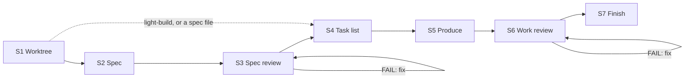
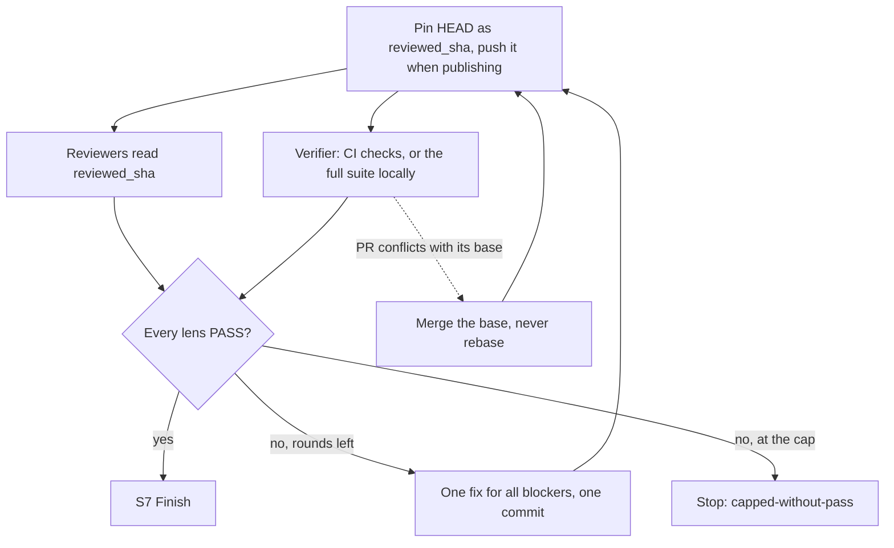

<div align="center">

#  Claude Autopilot

[English](../../README.md) · [中文](README.zh-CN.md) · [日本語](README.ja.md) · [한국어](README.ko.md) · [Español](README.es.md) · [Français](README.fr.md) · **Português**

</div>

*Esta é uma tradução; a versão de referência é o README em inglês.*

Um plugin para Claude Code e Codex que transforma um requirement em uma git branch pronta para revisão
sem perguntar nada a você. Ele faz o trabalho sozinho (código, documentação, designs, dados, planos),
agentes reviewer independentes o avaliam, e ele corrige até que todos aprovem. Nunca faz merge.

> Status: **v1.10.0**

## Instalação

No Claude Code, este repositório é o seu próprio marketplace:

```
/plugin marketplace add https://github.com/ophis/claude-autopilot.git
/plugin install autopilot@claude-autopilot
```

`ophis/claude-autopilot`, um caminho local ou o menu `/plugin` também funcionam. As versões usam semver
explícito (atualmente `1.10.0`). Para atualizar, execute `/plugin marketplace update claude-autopilot` e depois
a linha de instalação de novo. Nenhum outro plugin é necessário.

**Codex.** Invoque a skill `autopilot:build` ou `autopilot:light-build` com o seu requirement, ou peça ao Codex
para executar o caminho absoluto de `skills/build/SKILL.md` ou `skills/light-build/SKILL.md` de um checkout.
Requer suporte a subagents. Os reviewers herdam o modelo da sessão. Ainda não há manifest de marketplace para Codex.

## Uso

```
/autopilot:build add a function add(a,b) with a passing unit test
/autopilot:build path/to/spec.md
/autopilot:light-build add a --json flag to the status command
```

Espere um worktree e uma branch novos, loops de revisão que terminam em `VERDICT: PASS`, testes que realmente
rodaram, um commit por task e por rodada de correção, um relatório final e nenhum merge. Com um arquivo de spec
autocontido, o build pula S2 e S3. Para iterar, execute o próximo requirement a partir da branch da run concluída.
Ela continua essa branch, com seu próprio plan doc, uma revisão apenas dos novos commits e o mesmo PR.

|  | `build` | `light-build` |
| --- | --- | --- |
| Etapas | S1–S7 | S1, S4–S7 |
| Spec | escrita (S2), revisada (S3) | o requirement é a spec |
| Panel do S6 | todas as lenses core, mais as optional que combinam com a mudança | fixo: correctness, requirement-fidelity, doc, verification |
| Re-review do S6 | lenses que falharam, mais todas as core | lenses que falharam, mais o verifier, mais correctness após um FAIL do verifier |
| Limite | 3 rodadas por fase de revisão, alterável no requirement | 3 rodadas |
| Indicado para | trabalho complexo | tarefas simples, ou autonomia sem o rigor de uma spec |

O light-build não restringe o escopo: executa o que você der a ele. Escolher a skill é decisão sua.

Duas skills menores rodam sozinhas ou dentro de outra skill:

```
/autopilot:review doc=path/to/prd.md requirement=path/to/request.md
/autopilot:council requirement=path/to/request.md <question and its options>
```

`review` revisa um documento em relação às próprias palavras do autor e o corrige até os reviewers aprovarem ou
até 3 rodadas, com ou sem repositório git; `lenses=<dir>` troca pelos seus próprios reviewers. `council` coleta
escolhas independentes diante de uma bifurcação: 2–4 subagents novos veem apenas a pergunta, o requirement, os
documentos que ele cita e o código somente leitura.

## Como uma run funciona



| Etapa | O que acontece |
| --- | --- |
| S1 Worktree | Fica em qualquer branch que não seja `main`, `master` ou a padrão de origin. Caso contrário, cria um worktree e uma branch `<prefix>-<slug>`, sendo o prefixo o ID do ticket para trabalho de um único ticket, senão `autopilot`. Cria o plan doc e decide como publicar. |
| S2 Spec | Escreve a spec a partir do requirement e do código que ele toca. `check-spec.py` verifica as seções e se cada critério de aceitação tem um teste ou uma verificação. |
| S3 Spec review | Loop de revisão sobre a spec. Cada re-review cobre a spec inteira com o panel completo. |
| S4 Task list | Sem código. Cada task é um commit reversível: arquivos, interfaces entre tasks, testes a escrever primeiro, as verificações que ela roda, mensagem de commit. O comando de verify completo fica acima das tasks, com os checks de CI que rodam seus testes ao publicar. |
| S5 Produce | Implementa as tasks em ordem: os novos testes falham primeiro, depois o código, depois verificações que cobrem só os arquivos alterados, depois um commit. Pode passar uma task autocontida a um producer novo. Sem revisão por task. |
| S6 Work review | Loop de revisão sobre o trabalho em um commit fixado. Cada rodada de correção é um commit `fix(r<N>)`. |
| S7 Finish | Relatório e opções de integração, entre elas um squash merge. Copia os plan docs para o local de planos do projeto se o AGENTS.md ou CLAUDE.md dele indicar um. |

### Uma rodada de work review



As rodadas são em lote: todos os veredictos, depois uma correção, depois uma re-review. Só os veredictos dos
reviewers decidem, na gramática estrita `VERDICT / BLOCKING / NON-BLOCKING`; o orchestrator nunca anula um.
Um comando de teste que rodou 0 testes falha.

## CI e pull requests

Um repositório com CI nunca roda a suíte completa localmente enquanto a CI puder rodá-la. A run publica a branch
como um PR em rascunho (draft), e o verifier lê os checks de CI do commit revisado enquanto os outros reviewers
leem o código.

| `publish` | Quando | Faz push de | No final |
| --- | --- | --- | --- |
| `pr` | o requirement pede um PR | cada commit de task e cada pin do S6 | o build já postou a spec revisada como comentário; o relatório vai na descrição do PR; PR marcado como ready |
| `ci` | existe um workflow `pull_request` e o `gh` está autenticado para o host de origin | cada pin do S6 | um PR draft, para você ou quem chamou assumir |
| `none` | caso contrário, ou se um push for recusado em `ci` | nada | sem PR; verificações rodaram localmente |

- Um PR aberto na branch é adotado. Um que já está ready volta para draft durante a run e é marcado ready na
  convergência, para que ninguém faça merge no meio da revisão.
- O S4 nomeia os checks de CI que rodam os testes. Se nenhum rodar, a verificação é feita localmente.
- Antes de disparar uma rodada de revisão, a run consulta o PR por até 20 segundos. Um conflito de merge, ou uma
  CI que já falhou para o commit fixado, é corrigido antes de qualquer reviewer rodar; uma CI vermelha ainda conta
  como rodada. CI ainda em execução nunca segura a rodada: o verifier espera por ela junto com os outros reviewers.
- No modo `pr`, antes de fazer push de cada task depois da primeira, a run consulta a CI do push anterior, que
  rodou enquanto ela escrevia a task, e corrige na hora um resultado vermelho ou um conflito, para não gastar uma
  rodada de revisão.
- Uma falha de CI entra no loop de correção como qualquer blocker.
- CI ainda não concluída uma hora após a primeira consulta do verifier interrompe a run. Ela nunca recorre a uma
  suíte completa local.

## Decisões e paradas

Diante de uma bifurcação real (trade-offs bem diferentes, ou uma escolha cara de reverter) a run executa o council
(`skills/council`): registra a própria escolha, 2–4 subagents novos respondem com base na pergunta, no requirement,
nos documentos que ele cita e no código somente leitura, e ela decide e registra a contagem. Um producer delegado
diante de uma bifurcação retorna em vez disso um marcador `FORK:`, e o orchestrator decide e o dispara de novo.

Toda run termina com um único bloco JSON `autopilot-result` delimitado, para que quem chamou leia o resultado sem
analisar texto:

```autopilot-result
{ "status": "converged", "branch": "autopilot-add-json-flag", "base_ref": "<sha>", "head": "<sha>", "pr": "", "blockers": [], "reason": "" }
```

| `status` | Quando | `reason` |
| --- | --- | --- |
| `converged` | todas as lenses aprovaram e o S7 rodou | vazio |
| `capped-without-pass` | um loop de revisão atingiu o limite | `oscillation`, `unfixable` ou `requirements-conflict` |
| `stopped` | uma operação destrutiva (force-push, escrita fora do worktree, reescrita de histórico além da branch, rm ou reset de trabalho não commitado) sem aprovação automática (Claude: Auto Mode) | `destructive-op` |
| `stopped` | uma falha de fase ou capacidade ausente após uma nova tentativa, incluindo CI além do prazo | `phase-failure` |
| `stopped` | um requirement que se contradiz | `root-contradiction` |

`pr` é a URL do PR da run, em draft quando `publish=ci`. `blockers` lista os itens blocking em aberto quando não
convergiu.

## Chamar a partir de um workflow

As duas superfícies são skills, então outra skill ou workflow pode chamá-las pelo nome, assim como pode chamar
`review` e `council` sozinhas. Uma run aninhada fica na branch de quem chamou, a menos que seja uma branch padrão;
nesse caso cria o próprio worktree. Os documentos dela são nomeados por requirement, então as runs não colidem.
Quem chamou integra a branch retornada, lida do bloco `autopilot-result`.

## Estado e retomada

Cada run guarda o estado em um único plan doc ignorado, `.autopilot/<slug>-plan.md` no seu worktree (o build
adiciona um spec doc ao lado): o comando de verify, uma linha `RESUME:`, o log de progresso, os itens de revisão,
Notes com fatos do código e a task list. Após uma compactação de contexto, a run se reconstrói a partir dele e do
`git log`. Executar o mesmo requirement de novo retoma uma run não concluída.

## Review roster (`agents/`)

Cada reviewer tem uma lens. As lenses `core` de uma fase sempre rodam; uma lens `optional` roda quando o seu
`applies_to` combina com as palavras-chave da spec (S3) ou com os caminhos alterados (S6). Reviewers comuns são
somente leitura e nunca rodam a suíte completa.

| Arquivo | Lens | Fase | Nível |
| --- | --- | --- | --- |
| `reviewer-contract.md` | Modelo de autoria embutido nos reviewers comuns (não é disparado); o verification reviewer tem um contrato de execução próprio |  |  |
| `spec-fitness-reviewer.md` | Adequação da spec: lacunas, ambiguidade, escopo, testabilidade | spec | core |
| `architecture-reviewer.md` | Estrutura, fronteiras, acoplamento, extensibilidade | both | spec: core. work: optional, quando um arquivo é adicionado, removido, renomeado ou copiado (`@structural`) |
| `correctness-reviewer.md` | Lógica, casos extremos e de limite, caminhos de erro | work | core |
| `requirement-fidelity-reviewer.md` | O requirement e a spec construídos, sem nada faltando, desviado ou a mais | work | core |
| `doc-reviewer.md` | Documentação em qualquer lugar do repositório que a mudança tornou falsa; edições de documentação inchadas | work | core |
| `verification-reviewer.md` | Verificações completas no SHA revisado, localmente ou pela CI: comandos, códigos de saída, contagens de testes e falhas | work | core |
| `code-quality-reviewer.md` | Legibilidade, nomes, duplicação, código morto, complexidade, comentários | work | optional: arquivos de código |
| `test-reviewer.md` | Os testes verificam a spec e cobrem o código novo ou alterado | work | optional: arquivos de código ou de teste |
| `performance-reviewer.md` | Complexidade, N+1, alocação, vazamentos, pontos críticos | work | optional: arquivos de código |
| `security-reviewer.md` | Autorização, validação de entrada, segredos, injeção, cadeia de suprimentos | both | optional: sinais de autenticação, entrada, rede, E/S, dependências ou criptografia |

`scripts/select-panel.py` monta o panel do build a partir do frontmatter de cada arquivo
(`lens`, `phase`, `tier`, `applies_to`), então uma lens nova é um arquivo novo. O build roda todas as lenses core e
descarta uma optional marginal só com um motivo registrado. `review` também aceita uma pasta externa de reviewers
escritos conforme `reviewer-contract.md`; eles rodam como agentes genéricos. No Claude Code, cada reviewer roda como
`autopilot:<name>` com o `model:` e o `effort:` do seu frontmatter; no Codex, herda o modelo da sessão. Uma lens
revisada de novo começa do zero com os itens anteriores e, no S6, o diff da correção.

### Plugin workflow (`workflows/review-round.js`)

O transporte padrão de uma rodada, `Workflow({name: "autopilot:autopilot-review-round", args})`, roda todos os
membros em paralelo e valida cada veredicto contra um schema. Sem Workflow, as skills disparam os reviewers de
forma nativa.

- Entrada `args`: `{phase, members: [{agent, subagent_type, prompt}]}`.
- Saída: `{phase, verdicts: [{agent, VERDICT, BLOCKING, NON_BLOCKING, synthetic}]}`, na ordem dos membros.
  `VERDICT` é `PASS` só quando o reviewer disse `PASS` sem nenhum `BLOCKING`. Um membro sem veredicto vira `FAIL`
  com `synthetic: true`; as skills o disparam de novo uma vez de forma nativa.

## Desenvolvimento local

```
claude --plugin-dir /path/to/claude-autopilot              # load the working copy
/reload-plugins                                            # after an edit, in session
claude plugin validate /path/to/claude-autopilot --strict  # manifests and frontmatter
python3 scripts/lint-roster.py                             # after editing agents/
python3 tests/test_scripts.py                              # helper-script tests, stdlib only
```

Execute também o [smoke protocol](../../CONTRIBUTING.md#smoke-protocol). A documentação de desenvolvimento de cada
build fica em `dev-docs/<date>-<slug>-{spec,plan}.md`, ignorado pelo git.

O repositório é ao mesmo tempo o marketplace e o plugin:

```
claude-autopilot/
├── .claude-plugin/
│   ├── plugin.json               # name: autopilot (version 1.10.0)
│   └── marketplace.json          # name: claude-autopilot, plugins:[{source:"./"}]
├── skills/
│   ├── build/SKILL.md            # /autopilot:build
│   ├── build/spec.md             # spec-writing guide for S2
│   ├── build/scripts/check-spec.py     # S2 spec structure and AC coverage
│   ├── light-build/SKILL.md      # /autopilot:light-build
│   ├── review/SKILL.md           # /autopilot:review: review one document
│   └── council/SKILL.md          # /autopilot:council: independent picks at a fork
├── references/
│   ├── autopilot-common.md       # run rules build and light-build share
│   └── review-round.md           # how a review round runs and loops
├── scripts/
│   ├── select-panel.py           # (phase, signals) → panel JSON
│   ├── ci-verdict.py             # one commit's CI checks → verifier verdict
│   ├── pr.py                     # draft PR start / push / spec / finish
│   ├── resolve-branch.py         # S1: resume / stay / reuse / create / stop
│   ├── _frontmatter.py           # parser shared by the selector and the roster lint
│   └── lint-roster.py            # roster lint
├── workflows/
│   └── review-round.js           # plugin workflow: one parallel review round
├── agents/                       # review roster
│   ├── reviewer-contract.md      # authoring template, inlined into ordinary reviewers
│   └── *-reviewer.md             # one lens each
├── tests/
│   └── test_scripts.py           # stdlib unittest for the scripts
├── AGENTS.md                     # contributor guidance for Claude Code and Codex
└── README.md
```
