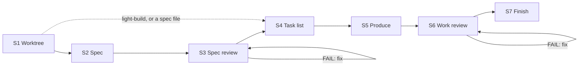
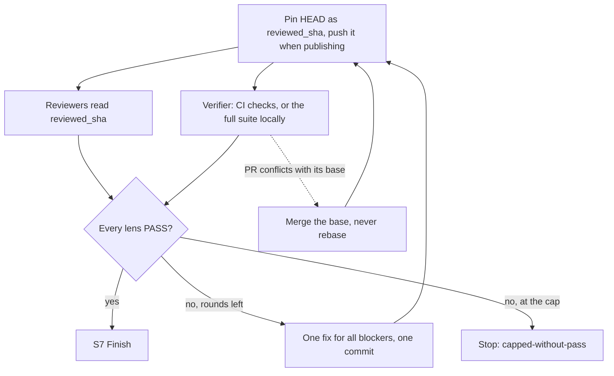

<div align="center">

#  Claude Autopilot

[English](../../README.md) · **中文** · [日本語](README.ja.md) · [한국어](README.ko.md) · [Español](README.es.md) · [Français](README.fr.md) · [Português](README.pt.md)

</div>

*本文为译文，以英文 README 为准。*

一个 Claude Code 和 Codex 插件，把一条 requirement 变成一个可供审阅的 git branch，
全程不向你提问。它自己完成工作（代码、文档、设计、数据、计划），由独立的 reviewer agent
评判，并不断修复直到全部通过。它从不合并。

> 状态：**v1.10.0**

## 安装

在 Claude Code 中，本仓库就是它自己的 marketplace：

```
/plugin marketplace add https://github.com/ophis/claude-autopilot.git
/plugin install autopilot@claude-autopilot
```

也可以用 `ophis/claude-autopilot`、本地路径或 `/plugin` 菜单安装。版本采用明确的
semver（当前为 `1.10.0`）。更新时先运行 `/plugin marketplace update claude-autopilot`，
再运行一次安装命令。不需要其他插件。

**Codex。** 带上你的 requirement 调用 `autopilot:build` 或 `autopilot:light-build`
skill，或让 Codex 运行某个 checkout 中 `skills/build/SKILL.md` 或
`skills/light-build/SKILL.md` 的绝对路径。需要 subagent 支持。reviewer 沿用会话的模型。
暂无 Codex marketplace manifest。

## 使用

```
/autopilot:build add a function add(a,b) with a passing unit test
/autopilot:build path/to/spec.md
/autopilot:light-build add a --json flag to the status command
```

你会得到：一个新的 worktree 和 branch，以 `VERDICT: PASS` 结束的 review 循环，真正跑过的测试，
每个 task 和每轮修复各一个 commit，一份最终报告，且不会合并。如果给的是自包含的 spec 文件，
build 会跳过 S2 和 S3。要继续迭代，就在上一次 run 完成的 branch 上运行下一条 requirement。
它会沿用该 branch，使用自己的 plan doc，只 review 新的 commit，并沿用同一个 PR。

|  | `build` | `light-build` |
| --- | --- | --- |
| 步骤 | S1–S7 | S1、S4–S7 |
| Spec | 编写（S2），审阅（S3） | requirement 即 spec |
| S6 panel | 所有 core lens，加上与改动匹配的 optional lens | 固定：correctness、requirement-fidelity、doc、verification |
| S6 re-review | 失败的 lens，加上所有 core lens | 失败的 lens，加上 verifier，verifier FAIL 后再加 correctness |
| 上限 | 每个 review 阶段 3 轮，可在 requirement 中修改 | 3 轮 |
| 适合 | 复杂工作 | 简单任务，或想要自主运行而不需要 spec 的严谨度 |

light-build 不把关范围，你给它什么它就做什么。选哪个 skill 由你决定。

另有两个较小的 skill，可单独运行，也可在其他 skill 中调用：

```
/autopilot:review doc=path/to/prd.md requirement=path/to/request.md
/autopilot:council requirement=path/to/request.md <question and its options>
```

`review` 对照作者本人的原话审阅一份文档，并修改它直到 reviewer 全部通过或达到 3 轮，
有没有 git 仓库都可以；`lenses=<dir>` 可换成你自己的 reviewer。`council` 在岔路口获取独立选择：
2–4 个全新的 subagent 只看到问题、requirement、其中提到的文档以及只读的代码。

## 一次 run 如何进行



| 步骤 | 做什么 |
| --- | --- |
| S1 Worktree | 只要不在 `main`、`master` 或 origin 的默认 branch 上，就留在当前 branch。否则创建一个 worktree 和名为 `<prefix>-<slug>` 的 branch：单个 ticket 的工作以 ticket ID 为前缀，否则为 `autopilot`。创建 plan doc 并决定如何发布。 |
| S2 Spec | 根据 requirement 和它涉及的代码编写 spec。`check-spec.py` 检查其章节，并确认每条验收标准都有对应的测试或检查。 |
| S3 Spec review | 对 spec 的 review 循环。每次 re-review 都由完整 panel 审阅整个 spec。 |
| S4 Task list | 不含代码。每个 task 是一个可回退的 commit：文件、跨 task 的接口、先写的测试、要跑的检查、commit message。完整的 verify 命令写在 task 之上；发布时还附上运行其测试的 CI 检查。 |
| S5 Produce | 按顺序实现各 task：新测试先失败，再写代码，然后只跑覆盖改动文件的检查，最后 commit。可以把自包含的 task 交给一个全新的 producer。不做逐 task review。 |
| S6 Work review | 在固定的 commit 上对工作做 review 循环。每轮修复是一个 `fix(r<N>)` commit。 |
| S7 Finish | 报告和集成选项，其中包括 squash merge。如果项目的 AGENTS.md 或 CLAUDE.md 指定了计划文档位置，就把 plan doc 复制过去。 |

### 一轮 work review



各轮按批进行：先收齐所有 verdict，再做一次修复，再做一次 re-review。只有 reviewer 的 verdict
说了算，采用严格的 `VERDICT / BLOCKING / NON-BLOCKING` 语法；orchestrator 从不推翻 verdict。
跑了 0 个测试的测试命令算失败。

## CI 与 pull request

有 CI 的仓库，只要 CI 能跑，就从不在本地跑完整测试套件。run 会把 branch 发布为 draft PR，
verifier 读取被审 commit 的 CI 检查，其他 reviewer 则阅读代码。

| `publish` | 何时 | 推送内容 | 结束时 |
| --- | --- | --- | --- |
| `pr` | requirement 要求一个 PR | 每个 task commit 和每次 S6 pin | build 已把审过的 spec 作为评论发出；报告写进 PR 正文；PR 标为 ready |
| `ci` | 有 `pull_request` workflow，且 `gh` 已为 origin 的主机认证 | 每次 S6 pin | 一个 draft PR，由你或调用方接手 |
| `none` | 其他情况，或在 `ci` 模式下推送被拒 | 不推送 | 没有 PR；检查在本地运行 |

- branch 上已有的 open PR 会被沿用。已是 ready 的 PR 在 run 期间退回 draft，收敛后再标为 ready，
  这样没人会在 review 中途合并它。
- S4 会写明运行测试的 CI 检查。如果没有，verification 在本地运行。
- 在派发一轮 review 之前，run 会查看 PR 最多 20 秒。合并冲突，或固定 commit 的 CI 已经失败，
  会在任何 reviewer 运行前先修复；红色的 CI 仍算一轮。仍在运行的 CI 从不拖住这一轮：
  verifier 会和其他 reviewer 一起等它。
- 在 `pr` 模式下，推送第一个之后的每个 task 前，run 会查看上一次推送的 CI（它在编写当前 task
  时已在运行），当场修复红色结果或冲突，免得耗掉一轮 review。
- CI 失败与其他 blocker 一样进入修复循环。
- verifier 首次查看一小时后 CI 仍未完成，run 就会停止。它从不退回到本地跑完整套件。

## 决策与停止

在真正的岔路口（取舍明显不同，或选择代价高、难以回退），run 会运行 council（`skills/council`）：
它先记录自己的选择，2–4 个全新的 subagent 根据问题、requirement、其中提到的文档和只读代码作答，
然后它做决定并记录票数。被委派的 producer 遇到岔路口时改为返回 `FORK:` 标记，
由 orchestrator 决定后重新派发。

每次 run 都以一个带围栏的 `autopilot-result` JSON 块结束，调用方无需解析文字即可读取结果：

```autopilot-result
{ "status": "converged", "branch": "autopilot-add-json-flag", "base_ref": "<sha>", "head": "<sha>", "pr": "", "blockers": [], "reason": "" }
```

| `status` | 何时 | `reason` |
| --- | --- | --- |
| `converged` | 所有 lens 通过且 S7 已运行 | 空 |
| `capped-without-pass` | 某个 review 循环达到上限 | `oscillation`、`unfixable` 或 `requirements-conflict` |
| `stopped` | 未获自动批准（Claude：Auto Mode）的破坏性操作（force-push、写到 worktree 之外、改写 branch 以外的历史、rm 或 reset 未提交的工作） | `destructive-op` |
| `stopped` | 重试一次后仍然阶段失败或缺少能力，包括 CI 超过截止时间 | `phase-failure` |
| `stopped` | 自相矛盾的 requirement | `root-contradiction` |

`pr` 是 run 的 PR URL，`publish=ci` 时为 draft。未收敛时，`blockers` 列出尚未解决的 blocking 项。

## 从 workflow 中调用

两个入口都是 skill，所以其他 skill 或 workflow 可以按名称调用它们，就像单独调用 `review`
和 `council` 一样。嵌套的 run 留在调用方的 branch 上，除非那是默认 branch，此时它会创建自己的
worktree。它的文档按 requirement 命名，因此多个 run 不会冲突。调用方从 `autopilot-result`
块中读取返回的 branch 并负责集成。

## 状态与恢复

每次 run 把状态保存在一个被忽略的 plan doc 中，即其 worktree 里的 `.autopilot/<slug>-plan.md`
（build 会在旁边加一个 spec doc）：verify 命令、一行 `RESUME:`、进度日志、review 项、记录代码库事实的
Notes 以及 task list。上下文压缩之后，run 会依据它和 `git log` 重建。再次运行同一条 requirement
会恢复未完成的 run。

## Review roster（`agents/`）

每个 reviewer 只有一个 lens。一个阶段的 `core` lens 总会运行；`optional` lens 在其 `applies_to`
匹配 spec 的关键词（S3）或改动的路径（S6）时运行。普通 reviewer 只读，从不运行完整测试套件。

| 文件 | Lens | 阶段 | 层级 |
| --- | --- | --- | --- |
| `reviewer-contract.md` | 内联进普通 reviewer 的编写模板（不会被派发）；verification reviewer 另有专门的执行契约 |  |  |
| `spec-fitness-reviewer.md` | Spec 适配度：缺口、歧义、范围、可测试性 | spec | core |
| `architecture-reviewer.md` | 结构、边界、耦合、可扩展性 | both | spec：core。work：optional，当有文件被新增、删除、重命名或复制时（`@structural`） |
| `correctness-reviewer.md` | 逻辑、边界与极端情况、错误路径 | work | core |
| `requirement-fidelity-reviewer.md` | requirement 和 spec 已实现，没有遗漏、偏离或多加 | work | core |
| `doc-reviewer.md` | 仓库中任何因改动而变得不实的文档；臃肿的文档修改 | work | core |
| `verification-reviewer.md` | 在被审 SHA 上运行完整检查，本地或读取 CI：命令、退出码、测试数和失败数 | work | core |
| `code-quality-reviewer.md` | 可读性、命名、重复、死代码、复杂度、注释 | work | optional：代码文件 |
| `test-reviewer.md` | 测试断言了 spec，并覆盖新增或改动的代码 | work | optional：代码或测试文件 |
| `performance-reviewer.md` | 复杂度、N+1、内存分配、泄漏、热点 | work | optional：代码文件 |
| `security-reviewer.md` | 授权、输入校验、密钥、注入、供应链 | both | optional：认证、输入、网络、I/O、依赖或加密相关信号 |

`scripts/select-panel.py` 依据每个文件的 frontmatter（`lens`、`phase`、`tier`、`applies_to`）
为 build 组建 panel，因此新增一个 lens 就是新增一个文件。build 运行所有 core lens，只有在记录理由时
才会去掉一个作用不大的 optional lens。`review` 也接受一个外部 reviewer 文件夹，其中的 reviewer 按
`reviewer-contract.md` 编写，作为通用 agent 运行。在 Claude Code 上，每个 reviewer 以
`autopilot:<name>` 运行，使用其 frontmatter 中的 `model:` 和 `effort:`；在 Codex 上则沿用会话的模型。
被 re-review 的 lens 会重新开始，带上它之前的 review 项，在 S6 中还带上修复的 diff。

### Plugin workflow（`workflows/review-round.js`）

一轮 review 的默认传输方式 `Workflow({name: "autopilot:autopilot-review-round", args})`
会并行运行每个成员，并按 schema 校验每个 verdict。没有 Workflow 时，skill 会以原生方式派发。

- 输入 `args`：`{phase, members: [{agent, subagent_type, prompt}]}`。
- 输出：`{phase, verdicts: [{agent, VERDICT, BLOCKING, NON_BLOCKING, synthetic}]}`，按成员顺序排列。
  只有当 reviewer 给出 `PASS` 且没有 `BLOCKING` 时，`VERDICT` 才是 `PASS`。没有给出 verdict 的成员
  记为 `FAIL` 并带 `synthetic: true`；skill 会以原生方式重新派发它一次。

## 本地开发

```
claude --plugin-dir /path/to/claude-autopilot              # load the working copy
/reload-plugins                                            # after an edit, in session
claude plugin validate /path/to/claude-autopilot --strict  # manifests and frontmatter
python3 scripts/lint-roster.py                             # after editing agents/
python3 tests/test_scripts.py                              # helper-script tests, stdlib only
```

另请运行 [smoke protocol](../../CONTRIBUTING.md#smoke-protocol)。每次 build 的开发文档放在
被 gitignore 的 `dev-docs/<date>-<slug>-{spec,plan}.md`。

本仓库既是 marketplace 也是插件：

```
claude-autopilot/
├── .claude-plugin/
│   ├── plugin.json               # name: autopilot (version 1.10.0)
│   └── marketplace.json          # name: claude-autopilot, plugins:[{source:"./"}]
├── skills/
│   ├── build/SKILL.md            # /autopilot:build
│   ├── build/spec.md             # spec-writing guide for S2
│   ├── build/scripts/check-spec.py     # S2 spec structure and AC coverage
│   ├── light-build/SKILL.md      # /autopilot:light-build
│   ├── review/SKILL.md           # /autopilot:review: review one document
│   └── council/SKILL.md          # /autopilot:council: independent picks at a fork
├── references/
│   ├── autopilot-common.md       # run rules build and light-build share
│   └── review-round.md           # how a review round runs and loops
├── scripts/
│   ├── select-panel.py           # (phase, signals) → panel JSON
│   ├── ci-verdict.py             # one commit's CI checks → verifier verdict
│   ├── pr.py                     # draft PR start / push / spec / finish
│   ├── resolve-branch.py         # S1: resume / stay / reuse / create / stop
│   ├── _frontmatter.py           # parser shared by the selector and the roster lint
│   └── lint-roster.py            # roster lint
├── workflows/
│   └── review-round.js           # plugin workflow: one parallel review round
├── agents/                       # review roster
│   ├── reviewer-contract.md      # authoring template, inlined into ordinary reviewers
│   └── *-reviewer.md             # one lens each
├── tests/
│   └── test_scripts.py           # stdlib unittest for the scripts
├── AGENTS.md                     # contributor guidance for Claude Code and Codex
└── README.md
```
